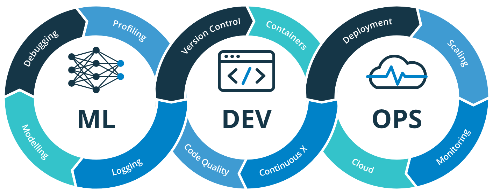
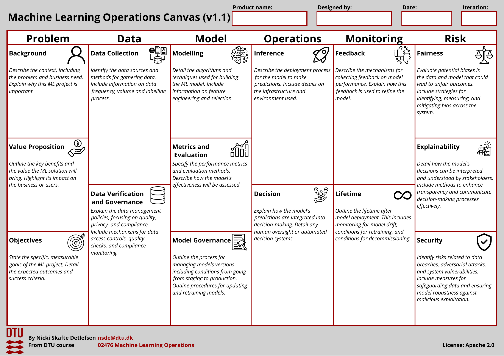

{ align=right width="130"}

# Designing machine learning systems

---

!!! quote
    *Machine learning engineering is 10% machine learning and 90% engineering.* <br> <br>
    Chip Huyen, author of *Designing Machine Learning Systems*

Building machine learning systems is not just about training models and deploying them. The *success* of an ML system
depends heavily on its **design process** — how well you understand the problem, define the objectives and plan the
system architecture before writing a single line of code.

As ML engineers and practitioners, it is tempting to dive straight into the data and algorithms. However, failing to
think through the design can lead to systems that are brittle, inefficient or simply incapable of meeting real-world
requirements. Said in another way, we want to minimize the amount of rework that we have to do and the overall
[technical debt](https://papers.nips.cc/paper_files/paper/2015/hash/86df7dcfd896fcaf2674f757a2463eba-Abstract.html)
that we accumulate.

In addition, you are often not the only stakeholder in an ML project. Data engineers, data scientists, product managers
and business stakeholders all need a shared picture of what is being built. A clear design that can be communicated to
both technical and non-technical people is therefore crucial.

If you want to go deeper on this topic after the module, we highly recommend Chip Huyen's book
*Designing Machine Learning Systems: An Iterative Process for Production-Ready Applications*, which gives a fantastic
overview of the processes that go into designing modern machine learning systems.

## Product design vs systems design

Before we start developing any machine learning models, we need to motivate and design the application. A useful way to
think about this (taken from the excellent
[Made With ML course](https://madewithml.com/courses/mlops/product-design/)) is to split design into two phases:

```txt
Product design (What & Why)  →  Systems design (How)
```

* **Product design** asks *what* we are building and *why*. Who are the users? What pain are we removing? What does
    success look like in measurable terms? Is machine learning even the right approach, or would a heuristic do?
* **Systems design** asks *how* we engineer that product end-to-end: data, metrics, modeling principles, inference,
    feedback and the surrounding project constraints. Made With ML covers this in their
    [systems design lesson](https://madewithml.com/courses/mlops/systems-design/).

This course spends most of its time on the *operations* side of MLOps — containers, CI/CD, cloud, deployment,
monitoring and so on. Those tools only pay off if you know *what system* you are trying to build. This module is about
getting that picture in place *before* you pick tools.

<figure markdown>
{ width="500" }
<figcaption>
MLOps is a cycle, not a one-way street. Design feeds development, development feeds operations, and monitoring sends
you back to design when requirements or data change.
</figcaption>
</figure>

## Thinking in systems

A useful mental model for production ML is a *closed loop*:

```txt
data → model → inference → decision → the real world → new data / feedback
```

If you only optimize the middle (the model), you ignore the parts that usually decide whether the project survives:
who acts on the prediction, how long labels take to arrive, what happens when the world drifts, and who is hurt when
the model is wrong.

A few ideas that show up again and again in well-designed ML systems:

* **Tradeoffs are inevitable.** Latency vs accuracy, batch vs online inference, interpretability vs performance,
    freshness vs cost. Write them down instead of discovering them in production.
* **Delays matter.** Labels may arrive weeks after a prediction. Retraining takes time. Drift detection always lags
    reality. Your design should say how the system behaves while you wait.
* **Feedback can be dangerous.** Predictions change user behavior, which changes the data you train on next. This is
    one of the classic sources of
    [hidden technical debt in ML systems](https://papers.nips.cc/paper_files/paper/2015/hash/86df7dcfd896fcaf2674f757a2463eba-Abstract.html).
* **Local optima are easy.** A model with great offline accuracy and no plan for serving, monitoring or decision rights
    is still a bad production system.

You do not need to become a systems-theory expert. You do need the habit of asking what sits *around* the model.

## The MLOps canvas

To make the design process concrete, we use an
[MLOps canvas](https://github.com/SkafteNicki/canvas) developed for this course. It is inspired by the
[Business Model Canvas](https://en.wikipedia.org/wiki/Business_Model_Canvas), the
[Machine Learning Canvas](https://www.ownml.co/machine-learning-canvas) by Louis Dorard, and the
[Made With ML canvas](https://madewithml.com/courses/mlops/product-design/), but tilted towards the questions that show
up when you actually try to *operate* ML in production.

<figure markdown>
{ width="1000" }
<figcaption>
The one-page MLOps canvas (v1.1). Six columns, read left to right, from the problem to the risks.
</figcaption>
</figure>

Download / open these two PDFs:

* [One-page fillable canvas](../canvas/canvas_en.pdf) — what you fill out
* [Full guide with questions and references](../canvas/full_mlops_canvas_en.pdf) — prompts for every box

The canvas has six columns that you should fill **left to right**:

| Column | Boxes | What you are forcing yourself to answer |
| --- | --- | --- |
| **Problem** | Background, Value Proposition, Objectives | Why does this exist, and how do we know we succeeded? |
| **Data** | Data Collection, Data Verification and Governance | Where does data come from, and can we trust it? |
| **Model** | Modelling, Metrics and Evaluation, Model Governance | How do we build, judge and version the model? |
| **Operations** | Inference, Decision | How are predictions produced and acted on? |
| **Monitoring** | Feedback, Lifetime | How do we learn after launch, and when do we retrain or retire? |
| **Risk** | Fairness, Explainability, Security | What can go wrong ethically, socially or adversarially? |

The header fields (Product name, Designed by, Date, Iteration) are not decoration. Treat the canvas as a *living*
document: bump the iteration number every time your understanding of the system changes in a meaningful way.

!!! tip "How to fill the canvas without getting stuck"

    * Prefer short, concrete sentences over slogans. "Reduce 30-day readmissions by 20%" beats "improve patient care".
    * On the first pass, finish the Problem and Data columns properly and only *stub* the later boxes.
    * Do **not** write tool names on the first pass (`Docker`, `MLflow`, `FastAPI`, ...). Describe *what* needs to happen;
        you will map tools onto the boxes later in the course.
    * Leaving Monitoring or Risk blank is itself a design smell. An open question is fine; silence is not.

### Worked example: inventory demand forecasting

Below is a compressed example of how a filled canvas might look for a retail inventory problem. Your own answers will
be shorter or longer depending on the project — the point is the *kind* of questions each box answers.

??? example "Retail company — inventory management"

    **Problem**

    *Background*
    : XYZ Retail overstocks some products and stock-outs others, which wastes warehouse space and loses sales.
        Store managers currently order from gut feeling plus a crude moving average.

    *Value proposition*
    : Better demand forecasts should reduce holding costs while keeping popular products available. Managers still make
        the final order decision; the model recommends quantities.

    *Objectives*
    : Primary — reduce inventory holding cost by 15% while keeping product availability at 98%. Secondary — improve
        forecast accuracy by 20% vs the current baseline on a held-out period.

    **Data**

    *Data collection*
    : Daily sales, inventory levels and deliveries from the ERP; promotion calendars; store metadata. Labels for
        "true demand" are tricky during stock-outs (you only observe sales). Need a policy for censored demand.

    *Data verification and governance*
    : Schema checks on daily extracts; access limited to the inventory analytics team; no customer-level PII in the
        training tables. Document known biases (new stores, COVID years, one-off viral products).

    **Model**

    *Modelling*
    : Start with a strong baseline (seasonal naive / gradient-boosted trees on lag features) before any deep sequence
        model. Features include lags, prices, promotions, holidays and store type.

    *Metrics and evaluation*
    : Offline: MAE / RMSE and bias per store-category. Online / business: stock-out rate, overstock rate, holding cost.
        Slice metrics by store size and product velocity so a good average does not hide bad segments.

    *Model governance*
    : Models versioned; staging vs production; weekly retrain candidate compared against the champion on a replay
        window before promotion.

    **Operations**

    *Inference*
    : Nightly batch forecasts for the next 14 days, written back into the ordering system before the morning planning
        meeting. Latency is not critical; freshness and reliability are.

    *Decision*
    : Recommendations appear as suggested order quantities. Managers can override; overrides are logged. Fully
        automatic ordering is out of scope for v1.

    **Monitoring**

    *Feedback*
    : Compare forecast vs realized sales; track override rate (high override often means the model is not trusted or
        not useful). Use a small holdout of stores/products that do not influence training immediately, to detect
        harmful feedback loops.

    *Lifetime*
    : Expect seasonal retrain; trigger review if MAE worsens by X% for two consecutive weeks or if a category's
        stock-out rate spikes. Plan for retiring models that no longer beat the baseline.

    **Risk**

    *Fairness*
    : Avoid systematically under-serving smaller or rural stores if training data is dominated by flagship locations.

    *Explainability*
    : Managers need simple reasons for a recommendation (promotion next week, last year spike, ...), not only a number.

    *Security*
    : Protect commercial sales data; control who can push a model to production; watch for poisoned or manually edited
        training extracts.

## Connecting the canvas to the rest of the course

One reason for introducing the canvas early is that the rest of the course fills it with *concrete* tools and practice.
As you go through the sessions, you should be able to point at a canvas box and say which module made that box real:

| Canvas focus | Where you will meet it in the course |
| --- | --- |
| Data collection, versioning, reproducibility | Organisation, data version control, experiment tracking |
| Modelling, metrics, debugging | Config/code structure, debugging, testing |
| Model governance, automation | CI/CD, cloud workflows |
| Inference and decisions | APIs, deployment, frontends |
| Feedback, lifetime, drift | Monitoring and data drifting |
| Fairness, explainability, security | Threaded through design, data governance and deployment choices |

You do not need to fill every box perfectly on day one. You *do* want a first draft that you can revise when you know
more.

## ❔ Exercises

Do these in a group of 3–4 if you can. Design work is easier (and more realistic) when someone can disagree with you.

1. Skim the
    [Made With ML product design lesson](https://madewithml.com/courses/mlops/product-design/)
    (and optionally the
    [systems design lesson](https://madewithml.com/courses/mlops/systems-design/)).
    In your own words, what is the difference between product design and systems design? Why does Made With ML put
    product design *before* model development?

    ??? success "Solution"

        Product design covers *what* to build and *why* (users, value, objectives, feasibility). Systems design covers
        *how* to engineer it (data, metrics, modeling principles, inference, feedback). Doing product design first
        reduces the risk of building a technically impressive model that nobody needed, or optimizing the wrong metric.

2. Open the [one-page canvas](../canvas/canvas_en.pdf) and the
    [question guide](../canvas/full_mlops_canvas_en.pdf). Pick **one** of the scenarios below (or use your course
    project if you already have one). Fill:

    * All three Problem boxes
    * Both Data boxes
    * At least one box from each of Model, Operations, Monitoring and Risk

    Time-box yourselves: roughly 5 minutes per box on this first pass. No tool names.

    ??? example "Scenario A — hospital readmissions"

        A hospital wants to predict which patients are at high risk of being readmitted within 30 days of discharge,
        so care teams can schedule follow-ups. Clinicians must stay in the loop for care decisions. Patient data is
        sensitive (think GDPR / health regulation). Labels arrive when readmission does or does not happen within
        30 days.

    ??? example "Scenario B — EV charging network"

        An energy company wants to decide where to place new charging stations and how to staff maintenance. They have
        usage logs from existing stations, traffic estimates and demographic data. City permits and grid capacity
        constrain what is possible. Wrong placement wastes capital for years.

    ??? example "Scenario C — content moderation assist"

        A community platform wants a model that flags potentially rule-breaking posts for human moderators. False
        positives annoy users; false negatives cause harm. Attackers may try to evade the model. Moderators disagree
        with each other, so labels are noisy.

3. On a piece of paper or a whiteboard, draw the closed loop for your scenario:

    ```txt
    data → model → inference → decision → world → feedback
    ```

    Mark **one delay** (for example label latency) and **one feedback risk** (how acting on predictions could change
    future data).

4. Swap canvases with another group. Spend 10 minutes on a red-team pass. Your job is not to be nice:

    * Cross out any Objective that is not measurable
    * Add a sticky note where Decision rights are unclear (who can override the model?)
    * Name one way the system can fail quietly for weeks without anyone noticing
    * Check that Risk is not empty

5. Write down three tradeoffs for your scenario (for example batch vs online inference, precision vs recall,
    automation vs human approval). For each tradeoff, note which canvas box captures it.

6. Without looking at the course schedule, guess which later modules will help you make the Operations and Monitoring
    columns more concrete. Then check your guess against the table in the previous section.

7. (Optional, recommended for project groups) Put the canvas (or a photo/export of it) into your project repository
    next to the project description. Set `Iteration` to `1`. Plan a revisit after you have worked on deployment and
    monitoring: update the boxes that were hand-wavy and bump the iteration number.

## Additional resources

* [Made With ML — Product design](https://madewithml.com/courses/mlops/product-design/)
* [Made With ML — Systems design](https://madewithml.com/courses/mlops/systems-design/)
* [Louis Dorard — Machine Learning Canvas](https://www.ownml.co/machine-learning-canvas)
* [ml-ops.org — MLOps Stack Canvas](https://ml-ops.org/content/mlops-stack-canvas) (more tool/infrastructure oriented;
    useful later when you map boxes to a concrete stack)
* [CRISP-ML(Q)](https://ml-ops.org/content/crisp-ml) — process model with quality/risk thinking in every phase
* [Google — Rules of ML](https://developers.google.com/machine-learning/guides/rules-of-ml) — especially "design metrics
    before models" and "keep the first model simple"
* Chip Huyen — *Designing Machine Learning Systems*
* [Sculley et al. — Hidden Technical Debt in Machine Learning Systems](https://papers.nips.cc/paper_files/paper/2015/hash/86df7dcfd896fcaf2674f757a2463eba-Abstract.html)
* Canvas source and generator: [SkafteNicki/canvas](https://github.com/SkafteNicki/canvas)
