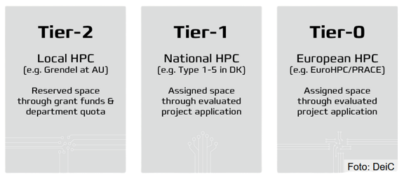
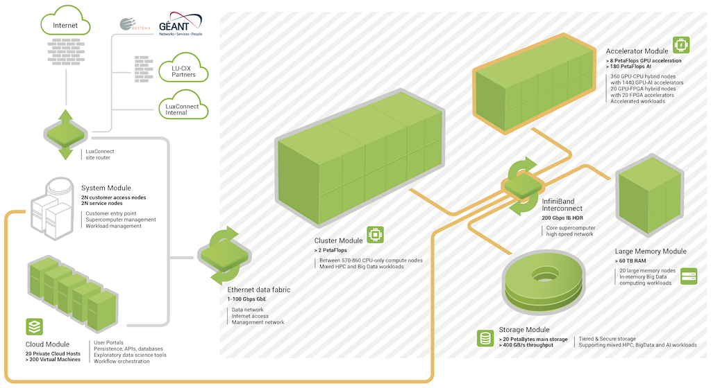

{ align=right width="130"}

# High Performance Clusters

---

!!! info "Optional Module"

As discussed in [the intro session on the cloud](../s6_the_cloud/README.md), cloud providers offer near infinite
compute resources. However, using these resources often comes at a hefty price and it is therefore important to be
aware of another resource many have access to: High Performance Clusters or HPC. HPCs exist all over the world, and
many times you already have access to one or can easily get access to one. If you are a university student you most
likely have a local HPC that you can access through your institution. Else, there exist public HPC resources that
everybody (with a project) can apply for. As an example in the EU we have
[EuroHPC](https://eurohpc-ju.europa.eu/index_en) initiative that currently has 14 different supercomputers with a
centralized location for
[applying for resources](https://eurohpc-ju.europa.eu/supercomputers/supercomputers-access-calls_en) that are both
open for research projects and start-ups.

Depending on your application, you may have different needs and it is therefore important to be aware also of the
different tiers of HPC. In Europe, HPC are often categorized such that Tier-0 are European centers with petascale
or even exascale machines, Tier 1 are National centers of supercomputers, and Tier 2 are Regional centers. The lower
the Tier, the larger applications it is possible to run.

<figure markdown>
{ width="800" }
</figure>

## Cluster architectures

In very general terms, an HPC can come as two different kind of systems: supercomputers and clusters. A supercomputer
(as shown below) is organized into different modules, that are separated by
network link. When you login to a supercomputer you will meet the front end which contains all the software needed to
run computations. When you submit a job it will get sent to the backend modules which in most cases includes: general
compute modules (CPU), acceleration modules (GPU), a memory module (RAM) and finally a storage module (HDD). Depending
on your application you may need one module more than another. For example in deep learning the acceleration module is
important but in physics simulation the general compute module / storage model is probably more important.

<figure markdown>
{ width="800" }
<figcaption> Overview of the Meluxina supercomputer that's part of EuroHPC.
<a href="https://hpc.uni.lu/old/blog/2019/luxembourg-meluxina-supercomputer-part-of-eurohpc/"> Image credit </a>
</figcaption>
</figure>

Alternatively, a cluster is a network of computers where each computer has its own CPU, GPU, RAM etc. and the
individual computers (or nodes) are then connected by a network. The important difference between a supercomputer and
a cluster system is how the resources are organized. When comparing supercomputers to clusters it is generally the
case that it is better to run on a cluster if you are only requesting resources that can be handled by a single node,
however it is better to run on a supercomputer if you have a resource intensive application that requires many
devices to communicate with each other.

Regardless of cluster architectures, on the software side of HPC, the most important part is what's called the
*HPC scheduler*. Without a HPC scheduler an HPC cluster would just be a bunch of servers with different jobs
interfering with each other. The problem is when you have a large collection of resources and a large collection of
users, you cannot rely on the users just running their applications without interfering with each other. A HPC scheduler
is in charge of managing that whenever an user request to run an application, they get put in a queue and whenever the
resources their application ask for are available the application gets run.

The biggest batch control systems for doing scheduling on HPC are:

* SLURM
* MOAB HPC Suite
* PBS Works
* LSF (Load Sharing Facility)

We are going to take a look at LSF as that is what is installed on our local university cluster.

### ❔ Exercises

[Exercise files](https://github.com/SkafteNicki/dtu_mlops/tree/main/s10_extra/exercise_files){ .md-button }

The following exercises are focused on local students at DTU that want to use our local
[HPC resources](https://www.hpc.dtu.dk/). That said, the steps in the exercise are fairly general to other types
of clusters. For the purpose of this exercise we are going to see how we can run this
[image classifier script](https://github.com/SkafteNicki/dtu_mlops/tree/main/s10_extra/exercise_files/image_classifier.py)
, but feel free to work with whatever application you want to.

1. Start by accessing the cluster. This can either be through `ssh` in a terminal or, if you want a graphical
    interface, [thinlinc](https://www.cendio.com/thinlinc/download) can be installed. In general we recommend
    following the steps [in the DTU HPC cluster guide](https://www.hpc.dtu.dk/?page_id=2501) for DTU students as the
    setup depends on if you are on campus or not.

2. When you have access to the cluster we are going to start with the setup phase. In the setup phase we are going
    to setup the environment necessary for our computations. If you have accessed the cluster through graphical
    interface start by opening a terminal.

    1. Let's start by setting up uv for controlling our dependencies. If you have not already worked with uv,
        please checkout module
        [M2 on package managers and virtual environments](../s1_development_environment/package_manager.md). In general
        you should be able to setup uv through these commands:

        ```bash
        curl -LsSf https://astral.sh/uv/install.sh | sh
        ```

    2. Close the terminal and open a new one for the installation to complete. Type `uv --version` in the terminal to
        check that everything is fine. Go ahead and create a new virtual environment that we can install dependencies in

        ```bash
        uv venv hpc_env --python 3.12
        ```

        and activate it:

        ```bash
        source hpc_env/bin/activate
        ```

    3. Copy over any files you need. For the image classifier script you need the
        [requirements file](https://github.com/SkafteNicki/dtu_mlops/tree/main/s10_extra/exercise_files/image_classifier_requirements.txt)
        and the actual
        [application](https://github.com/SkafteNicki/dtu_mlops/tree/main/s10_extra/exercise_files/image_classifier.py).

    4. Next, install all the requirements you need. If you want to run the image classifier script you can run this
        command in the terminal

        ```bash
        uv sync
        ```

        using this [pyproject.toml file](https://github.com/SkafteNicki/dtu_mlops/tree/main/s10_extra/exercise_files/pyproject.toml)
        (or if using a requirements.txt file, use `uv pip install -r image_classifier_requirements.txt`).
        Note that the PyTorch packages with bundled CUDA libraries are large (around 10 GB when installed), and your HOME
        directory on the cluster has a quota of 30 GB, so check that you have enough free space with
        `getquota_zhome.sh` before installing.

3. That's all the setup needed. You would need to go through the creating of the environment and installation of
    requirements whenever you start a new project (no need for reinstalling uv). For the next step we need to look
    at how to submit jobs on the cluster. We are now ready to submit our first job to the cluster:

    1. Start by checking the statistics for the different queues. Try to use the `classstat` command which should
        give an overview of the different queues, number of running jobs and number of pending jobs. You can also use
        the `nodestat` command to check the status of the individual nodes in a queue. On clusters using other
        scheduling systems the same information is often available through the `qstat` command.

    2. Figure out which queue you want to use. For the sake of the exercises it needs to be one with GPU support. For
        DTU students, any queue that starts with `gpu` is GPU accelerated.

    3. Now we are going to develop a bash script for submitting our job. We have provided an example of such
        [scripts](https://github.com/SkafteNicki/dtu_mlops/tree/main/s10_extra/exercise_files/jobscript.sh). Take a
        careful look and go through each line and make sure you understand it. Afterwards, change it to your needs
        (queue and student email).

    4. Try to submit the script:

        ```bash
        bsub < jobscript.sh
        ```

        You can check the status of your script by running the `bstat` command. Hopefully, the job should go through
        really quickly. Take a look at the output file, it should be called something like `gpu_*.out`. Also take a
        look at the `gpu_*.err` file. Do both files look as they should?

4. Let's now try to run our application on the cluster. To do that we need to take care of two things:

    1. First we need to make sure that the correct version of CUDA is loaded. A cluster system often contains
        multiple versions of specific software to suit the needs of all their users, and it is the users that are
        in charge of *loading* the correct software during job submission. You can check which modules are available
        on the cluster with

        ```bash
        module avail
        ```

        The provided `jobscript.sh` file already contains a `module load cuda/12.6` line, matching the CUDA version
        used in the official [DTU HPC jobscript examples](https://www.hpc.dtu.dk/?page_id=2759). You would only need
        to change that line if your application requires a different version of CUDA. Note that PyTorch applications
        installed from PyPI (as in this exercise) come with their own CUDA runtime bundled, so for the image
        classifier script the CUDA module is not strictly needed. Loading modules is however a general skill that
        you will need when working on clusters.

    2. We are now ready to add in our application. The only thing we need to take care of is telling the system to run
        it using the `python` version that is connected to our `hpc_env` we created in the beginning. Try typing:

        ```bash
        which python
        ```

        which should give you the full path. Then add to the bottom of the `jobscript.sh` file:

        ```bash
        uv run image_classifier.py \
            --trainer.accelerator 'gpu' --trainer.devices 1  --trainer.max_epochs 5
        ```

        which will run the image classifier script (change it if you are running something else).

    3. Finally submit the job:

        ```bash
        bsub < jobscript.sh
        ```

        and check when it is done that it has produced what you expected.

    4. (Optional) If your application supports multiple GPUs also try that out. You would first need to change the
        jobscript to request multiple GPUs (remembering that on the DTU cluster GPU jobs require at least 4 cores
        per requested GPU) and additionally you would need to tell your application to run on multiple GPUs. For
        the image classifier script the latter can be done by changing the `--trainer.devices` flag
        to `2` (or higher).

This ends the module on using HPC systems.
