{ align=right width="130"}

# Deployment testing

---

!!! info "Core Module"

In the module on [API testing](testing_apis.md) we learned how to check that our API returns the right outputs and
how it behaves under load. All of those tests run *before* the application reaches users. However, no matter how
good our offline evaluation is, there is one thing it can never fully capture: real users sending real data. This is
especially true for machine learning applications, where the data seen in production can differ from the test set in
subtle ways, and where we tend to retrain and redeploy models far more often than a traditional software team ships
new code.

**Deployment testing** (sometimes called *testing in production* or *progressive delivery*) covers the strategies we
can use to expose a new version of our application to production traffic in a controlled way, measure how it
behaves, and either promote it or roll it back. In this module we look at the three most common strategies:

* **Shadow deployment**: the new version receives a *copy* of the production traffic, but users never see its answers.
* **Canary deployment**: the new version receives a small, gradually increasing fraction of the real traffic.
* **A/B testing**: users are randomly split between two versions, and we use statistics to decide which one is better.

In practice these strategies are often chained together, with each stage exposing the new model to more users while
we gain more confidence in it:

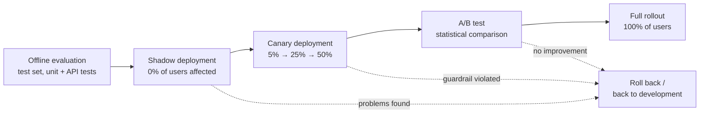

Before we start, it is worth getting an overview of the different strategies. Google Cloud's architecture guide on
[application deployment and testing strategies](https://web.archive.org/web/20240428093229/https://cloud.google.com/architecture/application-deployment-and-testing-strategies)
(now only available in the web archive) summarizes them in the following table, which also includes the pure
*deployment* strategies (recreate, rolling update, blue/green) for comparison:

| Pattern                                                                        | Zero downtime | Real production traffic testing | Releasing to users based on conditions | Rollback duration                       | Impact on hardware and cloud costs                                         |
| ------------------------------------------------------------------------------ | ------------- | ------------------------------- | -------------------------------------- | --------------------------------------- | -------------------------------------------------------------------------- |
| **Recreate**: v1 is terminated, then v2 is rolled out                          | ✗             | ✗                               | ✗                                      | Fast but disruptive because of downtime | No extra setup required                                                    |
| **Rolling update**: v2 gradually replaces v1                                   | ✓             | ✗                               | ✗                                      | Slow                                    | Can require extra setup for surge upgrades                                 |
| **Blue/green**: v2 is released alongside v1, traffic is switched after testing | ✓             | ✗                               | ✗                                      | Instant                                 | Need to maintain blue and green environments simultaneously                |
| **Canary**: v2 is released to a subset of users, followed by a full rollout    | ✓             | ✓                               | ✗                                      | Fast                                    | No extra setup required                                                    |
| **A/B**: v2 is released, under specific conditions, to a subset of users       | ✓             | ✓                               | ✓                                      | Fast                                    | No extra setup required                                                    |
| **Shadow**: v2 receives real-world traffic without impacting user requests     | ✓             | ✓                               | ✗                                      | Does not apply                          | Need to maintain parallel environments to capture and replay user requests |

## Setting up the exercises

Throughout this module we are going to work with a small, self-contained setup that runs entirely on your laptop, so
you can experiment without paying for cloud resources. For each strategy there are also optional exercises showing
how to do the same thing on [Cloud Run](cloud_deployment.md).

The setup consists of three pieces:

* A model service `model_versions_app.py` that serves a digit classifier trained on the
    [scikit-learn digits dataset](https://scikit-learn.org/stable/modules/generated/sklearn.datasets.load_digits.html).
    The environment variable `MODEL_VERSION` selects the model: `v1` is our current, slightly weaker production
    model and `v2` is the new candidate we want to roll out. Two further environment variables, `FAILURE_RATE` and
    `EXTRA_LATENCY_MS`, let us inject faults so we can see what a bad deployment looks like.
* A traffic generator `traffic_generator.py` that simulates many users sending requests. Because it knows the true
    label of every image, it also simulates the *delayed feedback* that a real system would collect (for example, a
    user correcting a wrong prediction).
* A router or proxy that sits in front of the model services and decides who gets which version. This is the part
    you will be implementing in the exercises.

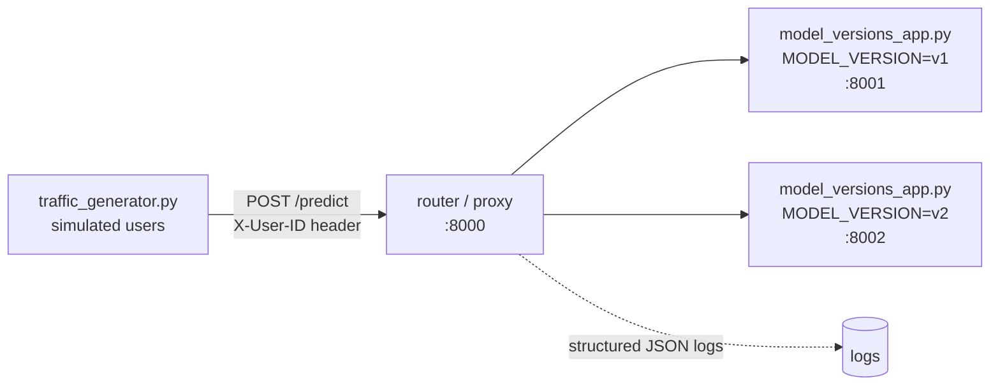

### ❔ Exercises

1. Make sure you have the exercise dependencies installed (`fastapi`, `uvicorn`, `httpx`, `scikit-learn`, `scipy`,
    `matplotlib` and `typer`), for example with

    ```bash
    uv add fastapi uvicorn httpx scikit-learn scipy matplotlib typer
    ```

2. Copy the files from the `s7_deployment/exercise_files` folder that start with `model_versions_app` and
    `traffic_generator` into your own project. Look through `model_versions_app.py` and make sure you understand what
    it does. In particular, notice that the response contains a `model_version` field and a `revision` field. The
    latter is read from the `K_REVISION` environment variable, which
    [Cloud Run sets automatically](https://docs.cloud.google.com/run/docs/container-contract) for every container.
    Why is it useful to include this information in the response of an API that is being deployment tested?

    ??? success "Solution"

        When multiple versions of an application are serving traffic at the same time, we need to know which version
        produced each response. Otherwise we have no way of attributing errors, latencies or bad predictions to a
        specific version. Including it in the response (and in the logs) is the simplest way to do this.

        ```python linenums="1" title="model_versions_app.py"
        --8<-- "s7_deployment/exercise_files/model_versions_app.py"
        ```

3. Start the two model versions in two different terminals:

    ```bash
    MODEL_VERSION=v1 uv run uvicorn model_versions_app:app --port 8001
    MODEL_VERSION=v2 uv run uvicorn model_versions_app:app --port 8002
    ```

    and check that both of them work by sending traffic directly to each of them:

    ```bash
    uv run traffic_generator.py --url http://localhost:8001 --n-requests 500
    uv run traffic_generator.py --url http://localhost:8002 --n-requests 500
    ```

    What is the accuracy and latency of each version?

    ??? success "Solution"

        You should see that `v2` is clearly more accurate than `v1`: on the test split, `v1` (a heavily regularized
        logistic regression trained on only 150 images) has an accuracy of about 91% and `v2` (a support vector
        machine trained on all the training data) about 99%. Both versions answer within a few tens of milliseconds
        when running locally.

---

## Shadow deployment

We start with the safest strategy. In a **shadow deployment** (also called *traffic mirroring* or *dark launching*)
the new version runs alongside the current production version. Every incoming request is sent to the production
version as usual, and a *copy* is sent to the shadow version. Users only ever receive the response from production,
while the response from the shadow version is logged and compared offline.

<figure markdown>
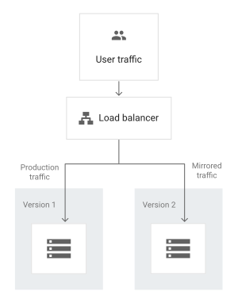{ width="400" }
<figcaption>
In a shadow deployment the load balancer mirrors production traffic to the new version. Only the responses from
version 1 are returned to the user.
<a href="https://web.archive.org/web/20240428093229/https://cloud.google.com/architecture/application-deployment-and-testing-strategies">
Image credit </a>
</figcaption>
</figure>

For machine learning models shadow deployments are particularly useful because they let us:

* Run the new model on **real production inputs**, including all the weird edge cases that never made it into our
    test set.
* Directly compare the predictions of the old and new model **on identical inputs**, which is much more informative
    than comparing two aggregate metrics.
* Measure **latency and resource usage** of the new model under real production load.
* Do all of this with **zero user impact**, because no user ever sees a shadow prediction.

The main drawbacks are cost (we are now running two full versions of our model) and complexity. Two things in
particular need careful thought:

1. **Side effects.** The shadow version must not change anything that users can observe. If our application writes to
    a database, sends emails or calls a payment service, the shadow version needs to use stubs instead. Otherwise
    the customer might, as the Google guide puts it, pay twice for their order.
2. **Latency.** The shadow call must never slow down the user's request. If we naively wait for both the
    production and shadow responses before answering, users pay the latency of the slowest of the two models.

The second point is best illustrated by comparing the two ways of implementing a shadow proxy:

=== "Naive (synchronous) shadowing"

    ```mermaid
    sequenceDiagram
        participant User
        participant Proxy
        participant Primary as Primary (v1)
        participant Shadow as Shadow (v2)
        User->>Proxy: POST /predict
        par
            Proxy->>Primary: request
            Primary-->>Proxy: prediction
        and
            Proxy->>Shadow: copy of request
            Shadow-->>Proxy: prediction (slow!)
        end
        Proxy-->>User: primary prediction
        Note over User,Proxy: user waits for max(primary, shadow)
    ```

=== "Fire-and-forget (asynchronous) shadowing"

    ```mermaid
    sequenceDiagram
        participant User
        participant Proxy
        participant Primary as Primary (v1)
        participant Shadow as Shadow (v2)
        User->>Proxy: POST /predict
        Proxy->>Primary: request
        Proxy-)Shadow: copy of request (background task)
        Primary-->>Proxy: prediction
        Proxy-->>User: primary prediction
        Note over User,Proxy: user only waits for primary
        Shadow-->>Proxy: prediction
        Proxy->>Proxy: log comparison
    ```

In production you usually do not write the shadow proxy yourself. Most load balancers and service meshes can mirror
traffic for you, for example [Istio](https://istio.io/latest/docs/tasks/traffic-management/mirroring/),
[NGINX](https://nginx.org/en/docs/http/ngx_http_mirror_module.html) or any implementation of the Kubernetes
[Gateway API](https://gateway-api.sigs.k8s.io/guides/http-request-mirroring/), which can also mirror just a
percentage of the requests. Some model serving frameworks, such as [Seldon Core](https://docs.seldon.ai/seldon-core-2/user-guide/experiment),
also have built-in support for shadow models. Cloud Run, however, does not support traffic mirroring, because its traffic
splitting always sends each request to exactly one revision. We are therefore going to implement a small shadow proxy
ourselves, which is also a great way to understand what the tools do under the hood.

### ❔ Exercises

1. Implement a shadow proxy in a file called `shadow_proxy.py`. It should be a FastAPI application with a
    `/predict` endpoint that

    * forwards the request to a primary service and returns its response to the user,
    * sends a copy of the request to a shadow service,
    * logs both predictions, both latencies and whether they agree, as **one JSON line per request**.

    The URLs of the primary and shadow services should be configurable through the environment variables
    `PRIMARY_URL` and `SHADOW_URL`. Start by implementing the naive version that uses `#!python asyncio.gather` to call
    both services at the same time and waits for both answers.

    ??? tip "Logging JSON instead of plain text"

        Writing one JSON object per line to standard output (structured logging) is a good habit. Cloud Run (and most
        other log collectors) [automatically parses such lines](https://docs.cloud.google.com/run/docs/logging) and
        stores them as a `jsonPayload`, which means you can later filter and query on individual fields instead of
        writing regular expressions against free text:

        ```python
        print(json.dumps({"message": "shadow_comparison", "primary_prediction": 3, "shadow_prediction": 8}), flush=True)
        ```

2. Make the shadow model artificially slow by restarting it with an extra 300 ms of latency:

    ```bash
    MODEL_VERSION=v2 EXTRA_LATENCY_MS=300 uv run uvicorn model_versions_app:app --port 8002
    ```

    Start your proxy on port 8000 and send traffic through it with the traffic generator. What happens to the latency
    the user sees?

3. Change your proxy so that the shadow request is sent as a *fire-and-forget* background task, such that the user
    only waits for the primary model. Measure the user latency again.

    ??? tip "Fire-and-forget in asyncio"

        `#!python asyncio.create_task(...)` schedules a coroutine to run in the background. Be aware that the event
        loop only keeps a *weak* reference to tasks, so a task that you do not keep a reference to
        [may be garbage collected before it finishes](https://docs.python.org/3/library/asyncio-task.html#asyncio.create_task).
        The recommended pattern is to store the tasks in a set and remove them when they are done:

        ```python
        background_tasks = set()

        task = asyncio.create_task(call_shadow(payload))
        background_tasks.add(task)
        task.add_done_callback(background_tasks.discard)
        ```

    ??? success "Solution"

        The solution below implements both modes, selected with the `SHADOW_MODE` environment variable. Start it with

        ```bash
        SHADOW_MODE=sync uv run uvicorn shadow_proxy:app --port 8000   # naive version
        SHADOW_MODE=async uv run uvicorn shadow_proxy:app --port 8000  # fire-and-forget
        ```

        In our runs (1000 requests, 20 concurrent users) with a shadow model that was 300 ms slower, the naive
        version had a user-facing p95 latency of about 450 ms, while the fire-and-forget version stayed at about
        130 ms. The users of the naive proxy pay for every millisecond the shadow model spends, which defeats the
        purpose of a shadow deployment.

        ```python linenums="1" title="shadow_proxy.py"
        --8<-- "s7_deployment/exercise_files/shadow_proxy.py"
        ```

4. Notice that the solution does not log the raw input image, only a hash of it. Why could it be a bad idea to log
    every input in a shadow deployment?

    ??? success "Solution"

        Production inputs can contain personal or sensitive data, and storing them in logs may violate privacy
        regulations such as GDPR or your company's data policies. In addition, logging every input can produce a
        very large volume of logs, which costs money to store and query. If you need the inputs for later analysis
        (for example, to label the cases where the models disagree), store them deliberately in a dedicated, access
        controlled location with a retention policy, or sample only a fraction of them.

5. Run the traffic generator for a couple of thousand requests through your shadow proxy (using a shadow model
    *without* extra latency this time). Then write a script `shadow_analysis.py` that reads the comparison logs and
    reports

    * the agreement rate between the primary and shadow model,
    * the error rate of the shadow model,
    * the p50 and p95 latency of both models,
    * a *disagreement matrix* that counts how often the primary predicted class `i` while the shadow predicted class
        `j`.

    ??? success "Solution"

        ```python linenums="1" title="shadow_analysis.py"
        --8<-- "s7_deployment/exercise_files/shadow_analysis.py"
        ```

        Running `uv run shadow_analysis.py shadow_log.jsonl --plot shadow_analysis.png` should produce a figure like
        the one below. The two models agree on about 92% of the requests. The off-diagonal cells
        show exactly which digits the models disagree on, which is a great starting point for looking at concrete
        examples.

        <figure markdown>
        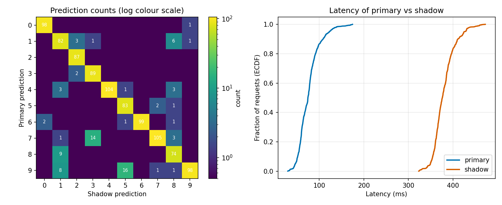{ width="800" }
        </figure>

6. Based on the analysis, can you conclude that the shadow model is *better* than the primary model? What would you
    need in order to answer that question?

    ??? success "Solution"

        No. A shadow deployment tells us *how often* and *where* the two models disagree, and whether the new model is
        fast and stable enough, but not which of them is right. To know which model is more accurate we need ground
        truth labels. In some applications these arrive later (for example, a user correcting a prediction or a
        transaction turning out to be fraudulent), and they can be joined with the shadow logs. Otherwise, a common
        approach is to manually label a sample of the disagreements. If the change is supposed to affect user
        behavior, we need to actually show the new model to users, which is where canary deployments and A/B tests
        come in.

7. (Optional) Deploy the two model versions and your shadow proxy to Cloud Run as three separate services, set the
    `PRIMARY_URL` and `SHADOW_URL` environment variables of the proxy to the URLs of the two model services, and send
    traffic to the proxy. Afterwards, export the comparison logs from Cloud Logging and analyze them with your script:

    ```bash
    gcloud logging read \
        'resource.labels.service_name="shadow-proxy" AND jsonPayload.message="shadow_comparison"' \
        --limit 5000 --format json > shadow_results.json
    uv run shadow_analysis.py shadow_results.json
    ```

---

## Canary deployment

A shadow deployment tells us that the new model *works*, but users never interact with it. The next step is to let a
small fraction of real users receive the new version. This is called a **canary deployment**, named after the
canaries that miners took into coal mines: if the canary got sick, the miners knew there was a problem before it
affected them. Similarly, if something is wrong with the new version, only the small fraction of users routed to the
canary is affected.

<figure markdown>
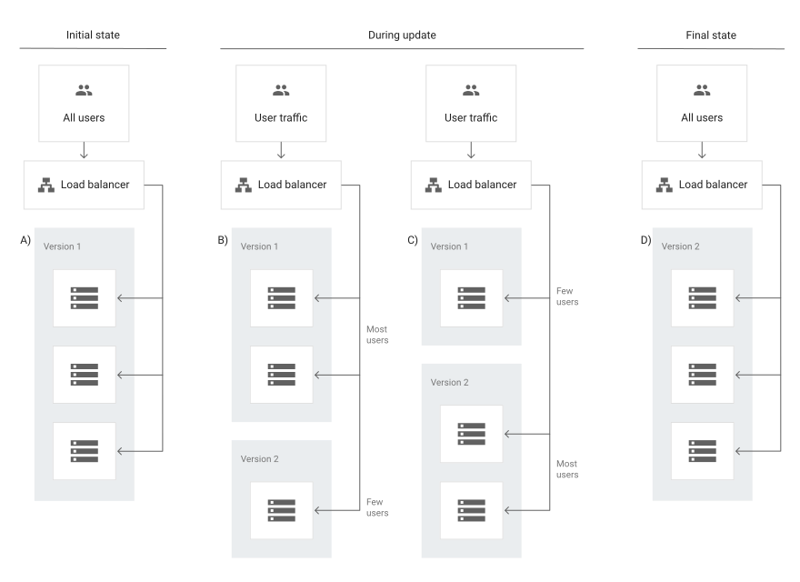{ width="800" }
<figcaption>
A canary deployment gradually moves traffic from version 1 to version 2: (A) all users are on version 1, (B) a few
users are routed to version 2, (C) most users are routed to version 2, and (D) all users are on version 2.
<a href="https://web.archive.org/web/20240428093229/https://cloud.google.com/architecture/application-deployment-and-testing-strategies">
Image credit </a>
</figcaption>
</figure>

A canary rollout typically looks like this:

1. Deploy the new version next to the current one, without sending traffic to it.
2. Route a small percentage of the traffic (for example 5%) to the new version.
3. Compare a few key metrics of the canary against the current version for a while.
4. If the metrics look good, increase the traffic (for example 5% → 25% → 50% → 100%). If they do not, immediately
    roll back by sending all traffic to the current version.

The [chapter on canarying releases](https://sre.google/workbook/canarying-releases/) in Google's *Site Reliability
Engineering Workbook* contains a lot of good advice on how to do step 3 well. A few of the main points are:

* **Compare against a concurrent control**, not against how the system behaved yesterday. Metrics naturally change
    over time (weekday vs. weekend, time of day), so the canary should be compared with the current version serving
    traffic *at the same time*.
* **Use a small number of metrics that reflect what users experience**, such as error rate and latency. The chapter
    recommends no more than a dozen, and warns that metrics like CPU usage are often too noisy to be useful.
* **Combine relative and absolute checks.** If both versions get worse at the same time (because of a shared
    dependency), a pure comparison would not catch it, so also check against your service level objectives.
* **Run only one canary at a time**, otherwise you cannot tell which change caused a problem.

These rules are called **guardrails**: conditions that must hold for the rollout to continue. For ML models, typical
guardrails are the error rate, the p95 or p99 latency (averages hide the slow requests that users complain about),
and properties of the predictions themselves, such as the distribution of predicted classes or the average model
confidence. A sudden shift in these can reveal problems like a preprocessing bug long before any ground truth labels
arrive.

### ❔ Exercises

In these exercises we are going to automate a canary rollout using a router that can split traffic between two
backends and report metrics for each of them.

1. Look at the file `ab_router.py` in the exercise folder. It is a small FastAPI application that forwards each
    request to one of two backends (`BACKEND_A` and `BACKEND_B`) according to some weights. Besides `/predict`, it
    has a couple of admin endpoints:

    * `GET` and `PUT /admin/weights` to read and change the traffic split,
    * `GET /admin/metrics` to get the number of requests, the error rate and the p50/p95 latency of each backend,
    * `POST /admin/metrics/reset` to reset the metrics.

    Start the two model services (without fault injection) and the router:

    ```bash
    uv run uvicorn ab_router:app --port 8000
    ```

    Set the traffic split to 90/10 with

    ```bash
    curl -X PUT localhost:8000/admin/weights -H "Content-Type: application/json" -d '{"a": 90, "b": 10}'
    ```

    send some traffic through the router and check the metrics endpoint. Does roughly 10% of the traffic end up at
    the canary?

    ??? example "Router implementation"

        We are going to come back to how the router assigns users to backends in the A/B testing section.

        ```python linenums="1" title="ab_router.py"
        --8<-- "s7_deployment/exercise_files/ab_router.py"
        ```

2. Write a script `canary_rollout.py` that automates the rollout. The script should go through the steps
    `[5, 25, 50, 100]` and, for each step:

    1. Set the traffic split on the router.
    2. Reset the metrics and send a batch of probe requests through the router.
    3. Read the metrics and check two guardrails: the canary error rate must not be more than 1 percentage point
        higher than the stable version, and the canary p95 latency must not be more than 1.5 times the stable p95
        latency.
    4. If a guardrail is violated, immediately send all traffic back to the stable version, print why, and exit with
        a non-zero exit code (so that a CI pipeline running the script would fail).

    If all steps pass, the canary has been promoted to 100% of the traffic.

    ??? success "Solution"

        The solution is structured around a small `TrafficBackend` interface with two implementations: one that
        talks to our local router and one that uses `gcloud` to update the traffic split on Cloud Run. This way the
        rollout logic is the same no matter where the model is deployed.

        ```python linenums="1" title="canary_rollout.py"
        --8<-- "s7_deployment/exercise_files/canary_rollout.py"
        ```

3. Run your rollout script against the healthy `v2` model. Then restart the `v2` service with a 5% failure rate,
    simulating a model that crashes on some inputs:

    ```bash
    MODEL_VERSION=v2 FAILURE_RATE=0.05 uv run uvicorn model_versions_app:app --port 8002
    ```

    and run the rollout script again. At which step is the rollout stopped, and how many users were affected by the
    bad version? You can try the same with `EXTRA_LATENCY_MS` instead of `FAILURE_RATE`.

    ??? success "Solution"

        Running the solution with `--plot canary_rollout.png` produces figures like the ones below. With the healthy
        model, the canary passes all guardrails and is promoted to 100%. With the faulty model, the error rate of the
        canary jumps above the guardrail and the rollout is rolled back at one of the first steps (5% or 25%,
        depending on how many of the few canary requests happen to fail), meaning that only a small fraction of the
        requests ever reached the bad version.

        <figure markdown>
        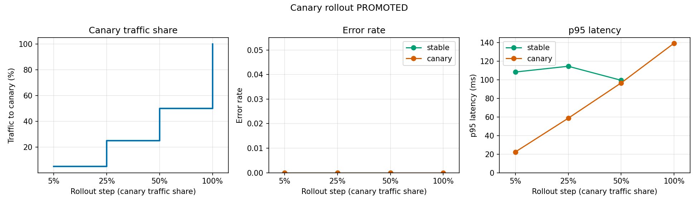{ width="800" }
        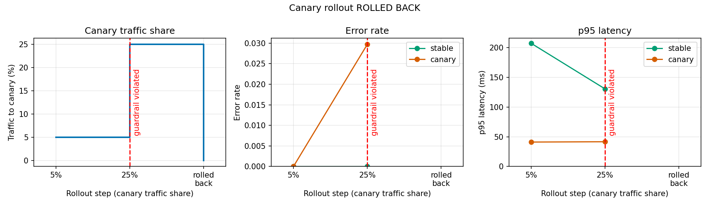{ width="800" }
        <figcaption>
        Top: a healthy canary is promoted to 100%. Bottom: a canary with a 5% failure rate is rolled back.
        </figcaption>
        </figure>

        Notice in the solution that the latency guardrail also has a small absolute slack (`--latency-slack-ms`).
        When latencies are only a few tens of milliseconds, the p95 of a few hundred requests is so noisy that a pure
        ratio would sometimes roll back a perfectly healthy canary. Also notice that at the 5% step, the canary only
        receives around 20 of the 400 probe requests, so a failure rate of a few percent may not be detected until a
        later step. This is the trade-off of canary deployments: the fewer users we expose, the less we can conclude
        from what we observe.

4. Our guardrails only look at error rate and latency. Write down at least two ML-specific guardrails you could add
    to the rollout script, and how you would compute them without having access to ground truth labels.

    ??? success "Solution"

        A few possibilities:

        * **Prediction distribution shift**: compare the distribution of predicted classes from the canary with the
            stable version, for example with a chi-squared test or the total variation distance. A preprocessing bug
            (for example, images that are no longer normalized) typically makes the model predict the same class for
            almost everything.
        * **Confidence**: compare the average (or the distribution of) the maximum softmax probability. A large drop
            means the model is uncertain on the production data.
        * **Input validation failures**: the fraction of requests that fail schema or range validation.
        * **Delayed feedback**: if some labels arrive later (users correcting predictions), the accuracy on those
            can be used as a guardrail in later, longer running steps.

        Many of these are exactly the drift metrics we will be looking at in the
        [module on data drifting](../s8_monitoring/data_drifting.md).

5. (Optional) Do a canary deployment on Cloud Run. Cloud Run keeps every deployment as an immutable *revision* and
    lets you [split traffic between revisions](https://docs.cloud.google.com/run/docs/rollouts-rollbacks-traffic-migration).
    Build a docker image from `model_versions_app.dockerfile`, push it to your artifact registry and

    1. deploy the stable version, giving the revision a readable name with `--revision-suffix`:

        ```bash
        gcloud run deploy mnist-classifier \
            --image <region>-docker.pkg.dev/<project-id>/<registry-name>/model-app:latest \
            --region <region> \
            --set-env-vars MODEL_VERSION=v1 \
            --revision-suffix v1 \
            --allow-unauthenticated
        ```

    2. deploy the new version *without sending any traffic to it*, but with a **tag**. A tag gives the revision its
        own URL of the form `https://canary---mnist-classifier-<hash>.<region>.run.app` that you can use to test it
        before any user sees it:

        ```bash
        gcloud run deploy mnist-classifier \
            --image <region>-docker.pkg.dev/<project-id>/<registry-name>/model-app:latest \
            --region <region> \
            --set-env-vars MODEL_VERSION=v2 \
            --revision-suffix v2 \
            --no-traffic \
            --tag canary
        ```

    3. send 10% of the traffic to the canary, check the logs, and increase or roll back as needed:

        ```bash
        # start the canary
        gcloud run services update-traffic mnist-classifier --region <region> \
            --to-revisions mnist-classifier-v2=10,mnist-classifier-v1=90
        # promote it
        gcloud run services update-traffic mnist-classifier --region <region> --to-revisions mnist-classifier-v2=100
        # ... or roll back
        gcloud run services update-traffic mnist-classifier --region <region> --to-revisions mnist-classifier-v1=100
        ```

    4. try running the `canary_rollout.py` script with `--backend cloudrun` against your service.

    !!! tip "Managed canary rollouts"

        Writing your own rollout script is a great way to understand how canary deployments work, but in production
        you would probably use a managed tool. On Google Cloud, [Cloud Deploy](https://docs.cloud.google.com/deploy/docs/deployment-strategies/canary)
        can do canary rollouts to Cloud Run, including running verification jobs between phases and automatically
        advancing the rollout when they pass. On Kubernetes, tools like [Argo Rollouts](https://argoproj.github.io/rollouts/)
        and [Flagger](https://flagger.app/) do the same, and [KServe](https://kserve.github.io/website/docs/model-serving/predictive-inference/rollout-strategies/canary-example)
        supports canary rollouts of models directly.

---

## A/B testing

A canary deployment answers the question *"is the new version safe?"*. An **A/B test** answers a different question:
*"is the new version better?"*. In an A/B test (also called an *online controlled experiment*) users are randomly
split into two groups. Group A gets the current version (the *control*) and group B gets the new version (the
*treatment*). Because the assignment is random, the only systematic difference between the two groups is the version
they are using, so any difference in our metrics that is larger than what we would expect by chance can be
attributed to the new version.

<figure markdown>
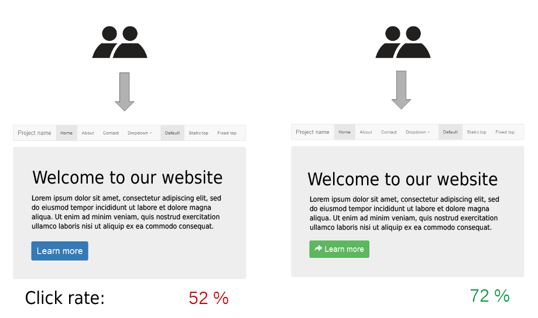{ width="500" }
<figcaption>
A classic A/B test from web development: does the color of the button affect how many users click it? Users are
randomly split into two groups, and the click rates are compared with a statistical test.
<a href="https://commons.wikimedia.org/wiki/File:A-B_testing_example.png"> Image credit </a>
</figcaption>
</figure>

<figure markdown>
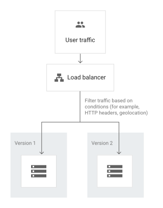{ width="500" }
<figcaption>
In an A/B test the load balancer routes users to different versions based on routing rules.
<a href="https://web.archive.org/web/20240428093229/https://cloud.google.com/architecture/application-deployment-and-testing-strategies">
Image credit </a>
</figcaption>
</figure>

For machine learning, A/B tests are the gold standard for answering questions that offline evaluation cannot, for
example whether a recommendation model with a better offline score actually makes users buy more, or whether a more
accurate but slower model leads to more users giving up. There are a few important things to get right.

**Randomize on the right unit and keep assignments sticky.** We usually want to randomize *users*, not requests,
such that the same user always sees the same version. Otherwise a user might get different answers to the same
question, and the measurements of the two groups are no longer independent. Note that Cloud Run's traffic splitting
assigns *requests* randomly. It does support [session affinity](https://docs.cloud.google.com/run/docs/configuring/session-affinity),
but this is cookie based and best effort, so for a proper A/B test we need to do the assignment ourselves. The
standard trick is to hash the user id together with the name of the experiment:

```python
bucket = int(hashlib.sha256(f"{experiment}:{user_id}".encode()).hexdigest(), 16) % 10_000
variant = "b" if bucket < 5_000 else "a"
```

This is deterministic (the same user always ends up in the same bucket), requires no database, works across many
replicas of the router, and including the experiment name means that different experiments get independent
assignments.

**Decide on the metric and sample size before starting.** The statistical test we use depends on the metric. The
table below (adapted from [Wikipedia](https://en.wikipedia.org/wiki/A/B_testing#Common_test_statistics)) gives an
overview of the most common choices:

| Assumed distribution | Example case                     | Standard test       | Alternative test |
| -------------------- | -------------------------------- | ------------------- | ---------------- |
| Gaussian             | Average revenue per user         | Welch's t-test      | Student's t-test |
| Binomial             | Click-through rate, accuracy     | Fisher's exact test | Barnard's test   |
| Poisson              | Transactions per paying user     | E-test              | C-test           |
| Multinomial          | Number of each product purchased | Chi-squared test    | G-test           |
| Unknown              | Latency, time to purchase        | Mann-Whitney U test | Gibbs sampling   |

For binomial metrics like accuracy with thousands of samples, the *two-proportion z-test* is a good approximation to
Fisher's exact test and is easy to compute by hand. The number of samples you need depends on three choices that must
be made *before* the experiment starts:

1. The **significance level** α, the probability of a false positive (typically 0.05).
2. The **power** 1 - β, the probability of detecting a real effect (typically 0.8).
3. The **minimum detectable effect** (MDE), the smallest improvement you care about.

The smaller the improvement you want to detect, the more samples you need, and the relationship is quadratic: halving
the MDE requires roughly four times as many samples.

<figure markdown>
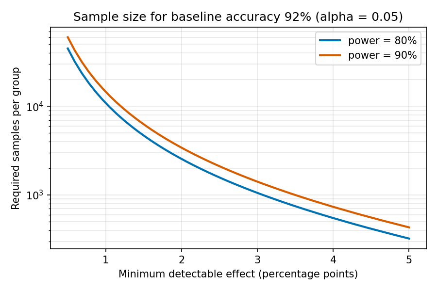{ width="600" }
<figcaption>
Required number of samples per group for detecting an improvement in accuracy from a baseline of 92%, as a function
of the minimum detectable effect. Note the logarithmic y-axis.
</figcaption>
</figure>

**Do not stop the experiment as soon as the result looks significant.** It is tempting to check the p-value every
day and stop the experiment once it drops below 0.05. This is called *peeking*, and it dramatically increases the
false positive rate, as explained in Evan Miller's classic post
[How Not To Run an A/B Test](https://www.evanmiller.org/how-not-to-run-an-ab-test.html). Either fix the sample size
in advance, or use methods designed for continuous monitoring, such as sequential tests.

**Check that the split is what you expected.** If you configured a 50/50 split but observe 5000 users in group A and
5300 in group B, something is wrong, for example a bug in the routing or one of the versions crashing more often so
that its requests are never logged. This is called a [sample ratio mismatch (SRM)](https://en.wikipedia.org/wiki/Sample_ratio_mismatch).
A [study from Microsoft](https://exp-platform.com/Documents/2019_KDDFabijanGupchupFuptaOmhoverVermeerDmitriev.pdf)
found that about 6% of their experiments had an SRM, and the results of such experiments cannot be trusted. It is
checked with a simple chi-squared test, and because it should essentially never fail, a very low threshold such as
p < 0.001 is commonly used.

### ❔ Exercises

1. Implement the function `assign_variant(user_id: str, experiment: str, weights: dict[str, float]) -> str` that
    deterministically assigns a user to a variant using the hashing trick shown above, but for an arbitrary number of
    variants with arbitrary weights (for example `{"a": 90, "b": 10}`). Write a couple of tests for it:

    * the same user always gets the same variant,
    * over many users, the observed split is close to the configured weights,
    * a weight of 100 for variant `a` always returns `a`,
    * two different experiments assign users independently.

    ??? success "Solution"

        The implementation is part of the router:

        ```python linenums="1" title="ab_router.py"
        --8<-- "s7_deployment/exercise_files/ab_router.py"
        ```

        and the tests could look like this:

        ```python linenums="1" title="test_ab_router.py"
        --8<-- "s7_deployment/exercise_files/test_ab_router.py"
        ```

2. A fellow student suggests using Python's built-in `#!python hash(user_id) % 100` instead of `hashlib`, since it is
    simpler. Try running

    ```bash
    uv run python -c "print(hash('user-42') % 100)"
    ```

    a couple of times. Why would this be a bad choice for assigning users in an A/B test?

    ??? success "Solution"

        Since Python 3.3, the hash of strings is randomized with a salt that is chosen when the Python process
        starts (see [`PYTHONHASHSEED`](https://docs.python.org/3/using/cmdline.html#envvar-PYTHONHASHSEED)), to
        protect against denial-of-service attacks. This means that every time the router restarts, and on every
        replica of the router, the same user would get a different variant. Assignments would no longer be sticky.
        Cryptographic hashes like SHA-256 always give the same result.

3. Start the two model services and the router (with a 50/50 split) and send traffic through it with the traffic
    generator:

    ```bash
    uv run traffic_generator.py --url http://localhost:8000 --n-requests 4000 --output traffic_log.jsonl
    ```

    Check in the log file that every user was always routed to the same variant.

4. Implement the following three functions for analyzing the results of an A/B test:

    * `two_proportion_ztest(successes_a, n_a, successes_b, n_b)` that returns the z-statistic and the two-sided
        p-value of the two-proportion z-test,
    * `required_sample_size(p_baseline, mde, alpha=0.05, power=0.8)` that returns the number of samples needed per
        group,
    * `sample_ratio_mismatch(n_a, n_b, expected=(0.5, 0.5))` that returns the p-value of a chi-squared test for SRM.

    ??? tip "Formulas"

        With `x_a` successes out of `n_a` samples in group A (and similarly for group B), the z-statistic uses the
        pooled success rate of both groups:

        ```python
        p_a, p_b = x_a / n_a, x_b / n_b
        p_pool = (x_a + x_b) / (n_a + n_b)
        z = (p_b - p_a) / sqrt(p_pool * (1 - p_pool) * (1 / n_a + 1 / n_b))
        p_value = 2 * scipy.stats.norm.sf(abs(z))  # two-sided
        ```

        For the sample size per group, with `p1` the baseline success rate and `p2 = p1 + mde`:

        ```python
        z_alpha = scipy.stats.norm.ppf(1 - alpha / 2)
        z_beta = scipy.stats.norm.ppf(power)
        n = (z_alpha + z_beta) ** 2 * (p1 * (1 - p1) + p2 * (1 - p2)) / mde**2
        ```

        For the SRM check, have a look at
        [`scipy.stats.chisquare`](https://docs.scipy.org/doc/scipy/reference/generated/scipy.stats.chisquare.html).

    ??? success "Solution"

        ```python linenums="1" title="ab_analysis.py"
        --8<-- "s7_deployment/exercise_files/ab_analysis.py"
        ```

5. Use your functions to answer the following questions:

    1. After one week, model A has made 9200 correct predictions out of 10000 and model B 9400 out of 10000. Is the
        difference statistically significant?
    2. How many samples per group would you need to detect an improvement in accuracy of 1 percentage point from a
        baseline of 92%?
    3. What would the p-value in question 1 be with the same accuracies, but only 1000 samples per group?

    ??? success "Solution"

        1. Yes. The z-statistic is about 5.5 and the p-value is around 3·10⁻⁸, far below 0.05.
        2. Around 10,900 samples per group (with α = 0.05 and a power of 0.8).
        3. With 1000 samples per group the z-statistic drops to about 1.75 and the p-value to about 0.08, so the
            same 2 percentage point difference would *not* be significant. The size of the effect is the same, but
            there is much more uncertainty about it.

6. Analyze the log file from exercise 3 with your functions. Always start with the SRM check, and only look at the
    accuracy difference if it passes. Is `v2` significantly better than `v1`?

    ??? success "Solution"

        Running `uv run ab_analysis.py traffic_log.jsonl` gives something like

        ```txt
        Assigned units: a=266, b=234  (SRM p-value 0.1524)
        Samples: a=2108, b=1892
        Accuracy a: 0.9203   b: 0.9857
        Difference: +0.0654  95% CI [+0.0527, +0.0782]
        z = 9.594, p-value = 0.00000 -> significant at 5%
        ```

        The SRM check passes, and `v2` is significantly better. Notice that the SRM check is done on the number of
        *users* in each group and not on the number of requests. Users are the unit we randomize, and because some
        users send many more requests than others, the number of requests per group can deviate from 50/50 far more
        than pure chance would suggest, even when the assignment works perfectly.

7. Let's convince ourselves that peeking is a problem. Write a simulation of many *A/A tests*: experiments where both
    variants are identical (for example, both have a true accuracy of 92%). For each simulated experiment, compute the
    p-value every 100 samples, up to 10000 samples per group. Compare the fraction of experiments that are
    (wrongly) declared significant when

    1. testing only once, at the end of the experiment,
    2. stopping as soon as any of the intermediate p-values is below 0.05.

    ??? success "Solution"

        ```python linenums="1" title="ab_peeking_simulation.py"
        --8<-- "s7_deployment/exercise_files/ab_peeking_simulation.py"
        ```

        Testing once at the end gives a false positive rate of 5%, exactly as expected with
        α = 0.05. Stopping at the first significant p-value gives a false positive rate of almost 40%, even
        though there is no difference at all between the two variants.

        <figure markdown>
        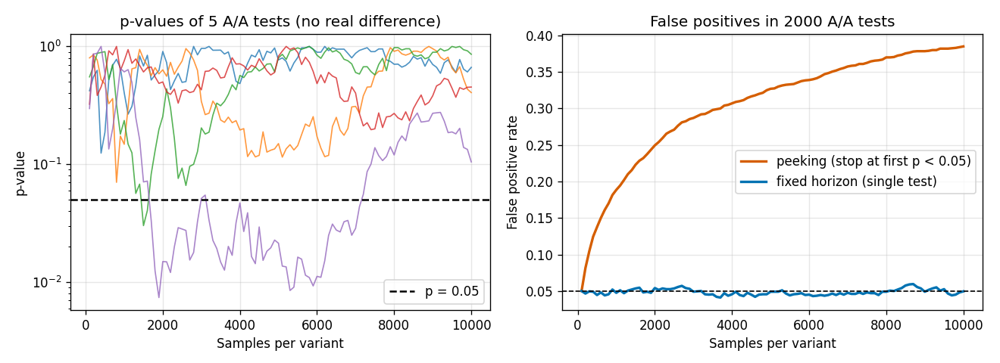{ width="800" }
        </figure>

8. (Optional) Run an A/B test on Cloud Run. Deploy the router as its own Cloud Run service, with the `BACKEND_A` and
    `BACKEND_B` environment variables pointing to the URLs of the two model versions (either two separate services,
    or the tagged revision URLs from the canary exercises). Send traffic through it, and export the assignment logs
    from Cloud Logging by filtering on `jsonPayload.message="ab_assignment"`.

---

## Choosing a strategy

Now that we have looked at all three strategies, the figure below summarizes when to use which. Remember that they
are not mutually exclusive: a careful rollout of a new model often goes through all of them.

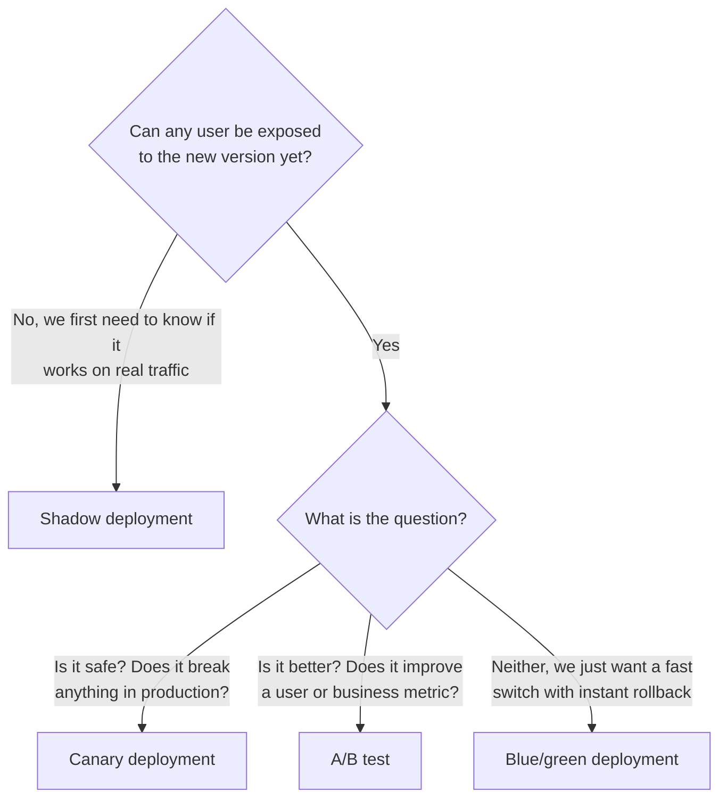

|                        | Shadow                           | Canary                  | A/B test                          |
| ---------------------- | -------------------------------- | ----------------------- | --------------------------------- |
| **Question answered**  | Does it work on production data? | Is it safe to roll out? | Is it better?                     |
| **Users exposed**      | None                             | Small, growing fraction | A fixed fraction (often 50%)      |
| **Unit of assignment** | Every request is mirrored        | Usually requests        | Usually users (sticky)            |
| **Typical duration**   | Hours to days                    | Minutes to hours        | Days to weeks                     |
| **Decision based on**  | Agreement, errors, latency       | Guardrail metrics       | Statistical test on target metric |
| **Main cost**          | Running two full versions        | Good monitoring         | Large sample sizes                |

---

## Beyond the basics

### Blue/green deployments

In a [blue/green deployment](https://martinfowler.com/bliki/BlueGreenDeployment.html) two complete environments are
running: *blue* (the current version) and *green* (the new version). The green environment is tested in isolation,
and then *all* traffic is switched over at once. Rolling back is as simple as switching back. In contrast to a canary
deployment, there is no gradual exposure. With Cloud Run, a blue/green deployment can be done with exactly the
commands we used in the canary exercises: deploy with `--no-traffic --tag green`, test the tagged URL, and finally
move all the traffic with `gcloud run services update-traffic <service> --to-tags green=100`.

### Feature flags

A [feature flag](https://martinfowler.com/articles/feature-toggles.html) (or feature toggle) moves the decision of
*which version a user gets* from the infrastructure into the application code. This way both models can be part of
the same deployment, and which one is used can be changed at runtime without redeploying:

```python
if flags.is_enabled("new-digit-model", user_id=user_id):
    prediction = new_model(x)
else:
    prediction = old_model(x)
```

Under the hood, a feature flag service does exactly what our `assign_variant` function does: it hashes the user id
to decide who gets the new feature, which also makes feature flags a convenient way to run canary rollouts and A/B
tests. Popular tools include [Unleash](https://www.getunleash.io/) and [GrowthBook](https://www.growthbook.io/)
(both open source, and GrowthBook also does the statistical analysis of A/B tests) and commercial services like
LaunchDarkly. [OpenFeature](https://openfeature.dev/) is a vendor-neutral, CNCF-hosted standard API for feature
flags, which lets you switch between these providers without changing your code.

### Multi-armed bandits

A classic A/B test sends a fixed fraction of the traffic to each variant for the entire experiment, even when it is
clear early on that one of them is worse. This has a cost, called *regret*: every user sent to a worse variant is a
missed opportunity. [Multi-armed bandit](https://en.wikipedia.org/wiki/Multi-armed_bandit) algorithms reduce the
regret by gradually shifting traffic towards the variants that perform best, while still exploring the others. Two
simple algorithms are:

* **Epsilon-greedy**: with probability ε (for example 0.1) send the request to a random variant, otherwise
    send it to the variant with the highest observed success rate so far.
* **Thompson sampling**: keep a Beta distribution over the success rate of each variant. For each request, draw a
    sample from each distribution and use the variant with the highest sample. Variants that we are uncertain about
    are explored naturally, and as the evidence accumulates, traffic concentrates on the best one.

The price is that bandits are designed to *maximize reward during the experiment*, not to give a clean statistical
answer to *how much* better one variant is. Bandits are therefore popular for things like recommendations and ads,
while A/B tests are preferred when the decision needs to be well founded.

1. (Optional exercise) Simulate three model variants with true success rates of 0.90, 0.92 and 0.95 over 10000
    requests. Compare the cumulative regret of a fixed equal split, epsilon-greedy and Thompson sampling.

    ??? success "Solution"

        ```python linenums="1" title="bandit_simulation.py"
        --8<-- "s7_deployment/exercise_files/bandit_simulation.py"
        ```

        <figure markdown>
        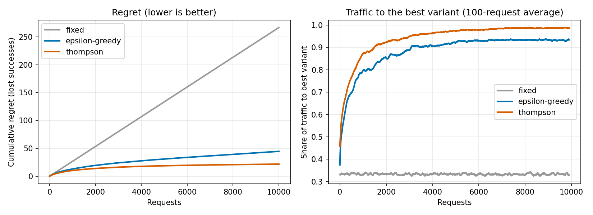{ width="800" }
        </figure>

        Averaged over 200 simulations, the fixed equal split ends up with a cumulative regret of about 270 (that is,
        270 fewer successes than if we had always used the best variant), epsilon-greedy about 45, and Thompson
        sampling about 22.

---

## 🧠 Knowledge check

1. In this module we used a router that we wrote ourselves for canary deployments and A/B tests, while Cloud Run also
    has built-in traffic splitting. What is the most important limitation of Cloud Run's traffic splitting for an A/B
    test, and why does it matter less for a canary deployment?

    ??? success "Solution"

        Cloud Run assigns each *request* randomly to a revision (session affinity only makes this sticky on a best
        effort basis), so the same user can see both versions. In an A/B test this breaks the independence between
        the two groups and makes it impossible to measure user-level metrics like retention. For a canary deployment
        the goal is to detect technical problems (errors, latency), which can be measured per request, so random
        per-request assignment is usually fine.

2. Your company's checkout service calls your fraud detection model, and you want to shadow test a new version of the
    model. The model returns a fraud score, and if the score is high, the service automatically blocks the customer's
    credit card. What do you need to be careful about?

    ??? success "Solution"

        Side effects. The shadow model's score must only be logged, and must never trigger blocking of a card. If the
        blocking happens inside the model service itself (instead of in the calling service), the shadow version
        needs to have this action disabled or stubbed out.

3. Your A/B test shows that model B has an accuracy of 93.5% and model A 93.0% after 500 samples each. Your manager
    asks if you can deploy model B. What do you answer?

    ??? success "Solution"

        Not yet. With 500 samples per group, the two-proportion z-test gives a p-value of about 0.75, so the
        difference is nowhere near significant. Detecting a difference of 0.5 percentage points at 80% power would
        require around 40,000 samples per group. The right thing to do is to decide on the minimum detectable effect,
        compute the required sample size *before* continuing, and only make a decision once that sample size has been
        reached. If such a small improvement does not matter, the test can instead be used to check that model B is
        *not worse* than model A.

4. You configured your router to split traffic 50/50 between two model versions. After a day, the logs contain 10,000
    requests from version A and 9,600 from version B. Version B has a much higher accuracy. What should you do?

    ??? success "Solution"

        Run an SRM check first. A chi-squared test of 10,000 vs. 9,600 against an expected 50/50 split gives a p-value
        of about 0.004, so there is good reason to suspect a sample ratio mismatch. A common cause is that version B
        fails on some requests, which are then never logged, so the requests it fails on (likely the hard ones) are
        missing from its accuracy calculation. The accuracy comparison cannot be trusted until the cause of the
        mismatch has been found.

5. Fill out the following table for the three strategies covered in this module:

    | Pattern           | Zero downtime | Real traffic | Conditional release | Rollback | Users exposed |
    | ----------------- | ------------- | ------------ | ------------------- | -------- | ------------- |
    | A/B testing       |               |              |                     |          |               |
    | Canary deployment |               |              |                     |          |               |
    | Shadow deployment |               |              |                     |          |               |

    ??? success "Solution"

        | Pattern           | Zero downtime | Real traffic | Conditional release | Rollback | Users exposed        |
        | ----------------- | ------------- | ------------ | ------------------- | -------- | -------------------- |
        | A/B testing       | ✓             | ✓            | ✓                   | Fast     | Treatment group      |
        | Canary deployment | ✓             | ✓            | ✗                   | Fast     | Small, growing share |
        | Shadow deployment | ✓             | ✓            | ✗                   | N/A      | None                 |

This ends the module on deployment testing. If you want to go deeper into A/B testing, the book
[Trustworthy Online Controlled Experiments](https://experimentguide.com/) by Kohavi, Tang and Xu is the standard
reference, written by people who ran the experimentation platforms at Microsoft, Google and LinkedIn. In the
[next module](ml_deployment.md) we are going to look at how to make the deployment of ML models themselves more
efficient.
