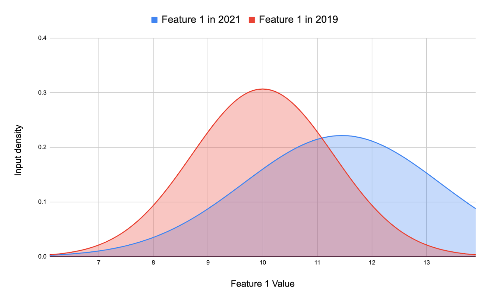
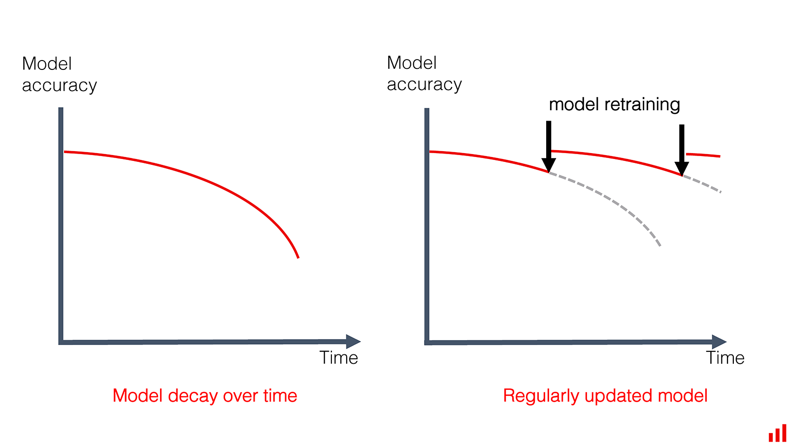
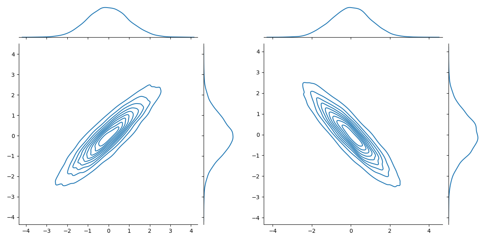

{align=right width="130"}

# Data drifting

---

!!! info "Core Module"

Data drifting is one of the core reasons why model accuracy degrades over time in production. For machine learning
models, data drift is the change in model input data that leads to model performance degradation. In practical terms,
this means that the model is receiving input that is outside the scope that it was trained on, as seen in the figure
below. This shows that the underlying distribution of a particular feature has slowly been increasing in value over
two years.

<figure markdown>
{ width="700" }
<figcaption>
<a href="https://www.picsellia.com/post/what-is-data-drift-and-how-to-detect-it-with-mlops"> Image credit </a>
</figcaption>
</figure>

In some cases, it may be that if you normalize some feature in a better way that you are able to generalize your model
better, but this is not always the case. The reason for such a drift is commonly some external factor that you
essentially have no control over. That really only leaves you with one option: retrain your model on the newly received
input features and deploy that model to production. This process is probably going to repeat over the lifetime of your
application if you want to keep it up-to-date with the real world.

<figure markdown>
{ width="700" }
<figcaption>
<a href="https://www.evidentlyai.com/blog/machine-learning-monitoring-data-and-concept-drift"> Image credit </a>
</figcaption>
</figure>

We have now come up with a solution to the data drift problem, but there is one important detail that we have not taken
care of: When we should actually trigger the retraining? We do not want to wait around for our model performance to
degrade, thus we need tools that can detect when we are seeing a drift in our data.

## ❔ Exercises

For these exercises we are going to use the framework [Evidently](https://github.com/evidentlyai/evidently), developed
by [EvidentlyAI](https://www.evidentlyai.com). Evidently currently supports detection for both regression and
classification models. The exercises are in large part taken from
[the Evidently getting started guide](https://docs.evidentlyai.com/quickstart_ml) and in general we recommend
if you are in doubt about an exercise to look at the [docs](https://docs.evidentlyai.com/) for the API and examples
(their documentation can be a bit lacking sometimes, so you may also have to dive into the source code).

!!! warning "Old Evidently API"

    Evidently rewrote its API in version `0.7`. The exercises use the new API (`from evidently import Report`,
    `from evidently.presets import ...`). Many blog posts, tutorials and LLM answers still use the old API with classes
    such as `TestSuite`, `ColumnMapping`, `DataQualityPreset` and `TargetDriftPreset`. That API now lives in the
    `evidently.legacy` namespace and is documented at [docs-old.evidentlyai.com](https://docs-old.evidentlyai.com/).
    Do not mix the two.

Additionally, we want to stress that data drift detection, concept drift detection, etc. is still an active field of
research and so there exist multiple frameworks for doing this kind of detection. In addition to Evidently,
we can also mention [NannyML](https://github.com/NannyML/nannyml), [WhyLogs](https://github.com/whylabs/whylogs) and
[Deepchecks](https://github.com/deepchecks/deepchecks).

1. Start by installing Evidently.

    === "Using pip"

        ```bash
        pip install evidently "pandas<3"
        pip install scikit-learn  # also needed if you do not have it already
        ```

        and remember to add this to your `requirements.txt` file.

    === "Using uv"

        ```bash
        uv add evidently "pandas<3" scikit-learn
        ```

    The `pandas<3` pin is needed because the current version of Evidently cannot be imported together with pandas 3
    (see [this issue](https://github.com/evidentlyai/evidently/issues/1974)). If `import evidently` fails with an
    `ImportError` mentioning `infer_dtype_from_object`, then you have pandas 3 installed.

2. Hopefully you have already gone through session [S7 on deployment](../s7_deployment/README.md). As part of the
    deployment exercises about GCP functions you should have developed an application that can classify the
    [iris dataset](https://archive.ics.uci.edu/ml/datasets/iris). Your solution should look something like the script
    below:

    ??? example "Example GCP function for iris classification"

        ```python linenums="1" title="sklearn_main_function.py"
        --8<-- "s7_deployment/exercise_files/sklearn_main_function.py"
        ```

    Start by converting your GCP function into a FastAPI application. The appropriate `curl` command should look
    something like this:

    ```bash
    curl -X 'POST' \
        'http://127.0.0.1:8000/predict?sepal_length=1.0&sepal_width=1.0&petal_length=1.0&petal_width=1.0' \
        -H 'accept: application/json' \
        -d ''
    ```

    and the response body should look like this:

    ```json
    { "prediction": "Iris-Setosa", "prediction_int": 0 }
    ```

    ??? success "Solution"

        ```python linenums="1" title="iris_fastapi_solution.py"
        --8<-- "s8_monitoring/exercise_files/iris_fastapi_solution.py"
        ```

    1. Next we are going to add some functionality to our application. We need to add that the input for the user is
        saved to a database whenever our application is called. However, to not slow down the response to our user we
        want to implement this as a *background task*. A background task is a function that should be executed after
        the user has gotten their response. Implement a background task that saves the user input to a database
        implemented as a simple `.csv` file. You can read more about background tasks
        [in the FastAPI background tasks tutorial](https://fastapi.tiangolo.com/tutorial/background-tasks/). The header
        of the database should look something like this:

        ```csv
        time,sepal_length,sepal_width,petal_length,petal_width,prediction
        2022-12-28 17:24:34.045649,1.0,1.0,1.0,1.0,1
        2022-12-28 17:24:44.026432,2.0,2.0,2.0,2.0,1
        ...
        ```

        Thus both input, timestamp and predicted value should be saved.

        ??? success "Solution"

            ```python linenums="1" title="iris_fastapi_solution_2.py"
            --8<-- "s8_monitoring/exercise_files/iris_fastapi_solution_2.py"
            ```

    2. Call your API a number of times to generate some dummy data in the database.

3. Create a new `data_drift.py` file where we are going to implement the data drifting detection and reporting. Start
    by adding both the real iris data and your generated dummy data as pandas dataframes.

    ```python
    import pandas as pd
    from sklearn import datasets
    reference_data = datasets.load_iris(as_frame=True).frame
    current_data = pd.read_csv('prediction_database.csv')
    ```

    If done correctly you will most likely end up with two dataframes that look like

    ```txt
    # reference_data
    sepal length (cm)  sepal width (cm)  petal length (cm)  petal width (cm)  target
    0                  5.1               3.5                1.4               0.2       0
    1                  4.9               3.0                1.4               0.2       0
    ...
    148                6.2               3.4                5.4               2.3       2
    149                5.9               3.0                5.1               1.8       2
    [150 rows x 5 columns]

    # current_data
    time                         sepal_length   sepal_width   petal_length   petal_width   prediction
    2022-12-28 17:24:34.045649   1.0            1.0            1.0           1.0           1
    ...
    2022-12-28 17:24:34.045649   1.0            1.0            1.0           1.0           1
    [10 rows x 6 columns]
    ```

    Standardize the dataframes such that they have the same column names and drop the time column from the
    `current_data` dataframe. Since our API logs the predicted class, rename the `prediction` column in `current_data`
    to `target` so it matches the `target` column in `reference_data`.

    ??? success "Solution"

        ```python
        import pandas as pd
        from sklearn import datasets
        reference_data = datasets.load_iris(as_frame=True).frame
        reference_data = reference_data.rename(
            columns={
                'sepal length (cm)': 'sepal_length',
                'sepal width (cm)': 'sepal_width',
                'petal length (cm)': 'petal_length',
                'petal width (cm)': 'petal_width'
            }
        )

        current_data = pd.read_csv('prediction_database.csv')
        current_data = current_data.drop(columns=['time'])
        current_data = current_data.rename(columns={'prediction': 'target'})  # standardize the column names
        ```

    1. Evidently can run directly on dataframes, but internally it works with a `Dataset` object, which combines a
        dataframe with a `DataDefinition`. The data definition tells Evidently how to interpret each column, e.g.
        which columns are numerical, which are categorical, which contain text etc. If you pass a plain dataframe,
        Evidently will try to guess the column types, which works for simple cases like this one but is not always
        correct.
        Look through the [data definition docs](https://docs.evidentlyai.com/docs/library/data_definition) and
        convert both dataframes to `Dataset` objects, where the four features are numerical and the `target` column
        is categorical.

        ??? success "Solution"

            ```python
            from evidently import DataDefinition, Dataset
            feature_columns = ['sepal_length', 'sepal_width', 'petal_length', 'petal_width']
            data_definition = DataDefinition(numerical_columns=feature_columns, categorical_columns=['target'])
            reference_dataset = Dataset.from_pandas(reference_data, data_definition=data_definition)
            current_dataset = Dataset.from_pandas(current_data, data_definition=data_definition)
            ```

    2. Add the following code to the `data_drift.py` file to create a report on the data drift:

        ```python
        from evidently import Report
        from evidently.presets import DataDriftPreset
        report = Report(metrics=[DataDriftPreset()])
        snapshot = report.run(current_data=current_dataset, reference_data=reference_dataset)
        snapshot.save_html('report.html')
        ```

        Note that the `Report` object only holds the configuration of what we want to compute, and `report.run(...)`
        returns a new `Snapshot` object that contains the actual results. Open the generated `.html` page. What does
        it say about your data? Has it drifted? Make sure to poke around to understand what the different plots are
        actually showing.

    3. Data drifting is not the only kind of reporting evidently can make. We can also get reports on data quality.
        Look through the [list of presets](https://docs.evidentlyai.com/metrics/all_presets) in evidently's
        documentation and add the preset that has to do with data quality to the report. Try adding a few `NaN` values
        to your `current_data` dataframe, re-create `current_dataset` from it (the `Dataset` does not see changes made
        to the dataframe after it was created) and re-run the report. Check out the report and go over the generated
        plots and make sure that it picked up on the missing values you just added.

        ??? success "Solution"

            The `DataSummaryPreset` computes statistics on the data quality (missing values, duplicated rows, constant
            columns, value ranges etc.):

            ```python
            from evidently.presets import DataDriftPreset, DataSummaryPreset
            report = Report(metrics=[DataDriftPreset(), DataSummaryPreset()])
            ```

    4. Another important kind of drift is called *target drift*, where the distribution of the target values has
        changed. If your training data was balanced, and you are now seeing a lot of one class being predicted this may
        indicate that your model is not performing as expected or that external factors have changed, which means that
        you should retrain your model. Evidently does not have a dedicated preset for target drift; instead you can
        compute the drift of any single column. Look through the
        [list of metrics](https://docs.evidentlyai.com/metrics/all_metrics), find the metric that computes the drift of
        a single column and add it to the report for the `target` column. Restrict the `DataDriftPreset` to only the
        four features (hint: `columns` argument), such that feature drift and target drift are reported separately.

        ??? success "Solution"

            The `ValueDrift` metric computes the drift of a single column:

            ```python
            from evidently.metrics import ValueDrift
            from evidently.presets import DataDriftPreset, DataSummaryPreset
            report = Report(
                metrics=[
                    DataDriftPreset(columns=feature_columns),
                    DataSummaryPreset(),
                    ValueDrift(column='target'),
                ]
            )
            ```

            If we do not restrict the `DataDriftPreset`, it will compute drift for all columns, including the `target`
            column.

4. Evidently reports are meant for debugging, exploration and reporting of results. However, if we want to integrate
    evidently functionality into our already developed pipelines, either as a simple script, as part of a GitHub action
    workflow or something else, we need to be able to extract the results in a more programmatic way. This is done
    using *tests*. In Evidently a test is a condition attached to a metric, e.g. "the number of missing values should
    be equal to 0", which is added through the `tests` argument of the metric together with the conditions from
    `evidently.tests` (`eq`, `lt`, `lte`, `gt`, `gte`, `is_in`, ...). The result of each test is stored in the
    snapshot. Implement a simple test that checks if there are any missing values in our dataset and print the results
    to the console.

    ??? success "Solution"

        Using the `.json()` (or `.dict()`) method on a snapshot we can programmatically extract the results. The returned
        dictionary contains a key `tests` with a list of all test results. Each test result has a `name`, a
        `description` and a `status` that is either `SUCCESS`, `FAIL`, `WARNING` or `ERROR`.

        ```python
        import json
        from evidently import Report
        from evidently.metrics import DatasetMissingValueCount
        from evidently.tests import eq
        report = Report(metrics=[DatasetMissingValueCount(tests=[eq(0)])])
        snapshot = report.run(current_data=current_dataset, reference_data=reference_dataset)
        test_results = json.loads(snapshot.json())['tests']
        for test in test_results:
            print(test['status'], test['description'])
        print("All tests passed: ", all(test['status'] == 'SUCCESS' for test in test_results))
        ```

    1. Presets come with a set of default tests that can be enabled with `#!python Report(..., include_tests=True)`.
        Some default conditions are derived from the reference dataset (e.g. the `DataSummaryPreset` compares the
        number of rows and missing values to the reference), while others are fixed (e.g. the `DataDriftPreset`
        tests if the share of drifted columns is below 50%). Enable the default tests for the `DataDriftPreset` and
        the `DataSummaryPreset` and look at the generated report. Which tests fail?

    2. Take a look at the [list of metrics](https://docs.evidentlyai.com/metrics/all_metrics) and the
        [tests documentation](https://docs.evidentlyai.com/docs/library/tests) and pick 5 metrics of your choice. Add a
        test to each of them, where at least 1 fails on your data. Then try changing the conditions of the tests so they
        better fit your use case and get them all passing.

    ??? example "Full `data_drift.py` script"

        Below is a full script, that runs on the iris dataset (using part of the data as the reference and the rest as
        the current data) and combines the report and tests from the exercises above.

        ```python linenums="1" title="data_drift.py"
        --8<-- "s8_monitoring/exercise_files/data_drift.py"
        ```

5. (Optional) When doing monitoring in practice, we are not always interested in running on all the data collected from
    our API, maybe only the last `N` entries or maybe just from the last hour of observations. Since we are already
    logging the timestamps of when our API is called we can use that for filtering. Implement a simple filter that

    * Takes an integer `n` and returns the last `n` entries in our database
    * Takes an integer `t` that filters out observations older than `t` hours

    ??? success "Solution"

        ```python
        import pandas as pd
        def filter_data(data: pd.DataFrame, n: int | None = None, t: int | None = None) -> pd.DataFrame:
            if n is not None:
                return data.tail(n)
            if t is not None:
                data['time'] = pd.to_datetime(data['time'], utc=True)  # Ensure the 'time' column is a datetime object
                t_hours_ago = pd.Timestamp.now(tz='UTC') - pd.Timedelta(hours=t)
                return data[data['time'] > t_hours_ago]
            return data
        ```

6. Drift detection is mainly designed for structured data, e.g., tabular data (this holds for Evidently and nearly every
    other framework). Thus, the question then becomes how we can extend unstructured data such as images or text? The
    general solution is to extract structured features from the data which we can then run the analysis on.

    1. For images the simple solution would be to flatten the images and consider each pixel a feature,
        however this does not work in practice because changes in the individual pixels do not really tell us anything
        about the image. Instead, we should derive some features such as:

        * Average brightness
        * Contrast of an image
        * Image sharpness
        * ...

        These are all numbers that can make up a feature vector for a given image. Try doing this yourself, for
        example by extracting such features from the MNIST and FashionMNIST datasets, and check if you can detect a
        drift between the two sets.

        ??? success "Solution"

            ```python linenums="1" title="image_drift.py"
            --8<-- "s8_monitoring/exercise_files/image_drift.py"
            ```

    2. (Optional) For text a common approach is to extract some higher-level embedding such as the very classical
        [GLOVE](https://github.com/stanfordnlp/GloVe) embedding. Evidently also has built-in support for text: if a
        column is marked as a text column in the `DataDefinition`, the `DataDriftPreset` will train a small classifier
        to tell the reference and current text apart, and if it can do that, the text has drifted. Additionally, we
        can extract simple features from the text using
        [descriptors](https://docs.evidentlyai.com/docs/library/descriptors) such as `TextLength`, `WordCount` and
        `Sentiment`, which are added when creating the dataset. Try running drift detection on a small text dataset
        of your choice using both approaches.

        ??? success "Solution"

            ```python
            from evidently import DataDefinition, Dataset, Report
            from evidently.descriptors import Sentiment, TextLength
            from evidently.presets import DataDriftPreset, TextEvals
            data_definition = DataDefinition(text_columns=['review'])
            descriptors = [TextLength('review', alias='Length'), Sentiment('review', alias='Sentiment')]
            reference = Dataset.from_pandas(reference_df, data_definition=data_definition, descriptors=descriptors)
            current = Dataset.from_pandas(current_df, data_definition=data_definition, descriptors=descriptors)
            # DataDriftPreset checks drift of the raw text and of the descriptors, TextEvals summarizes the descriptors
            report = Report(metrics=[DataDriftPreset(), TextEvals()])
            snapshot = report.run(current_data=current, reference_data=reference)
            snapshot.save_html('text_drift.html')
            ```

    3. Instead of manually specifying the features, let's take a deep learning-based approach to getting features from
        unstructured data. To do this let's consider the [CLIP](https://arxiv.org/abs/2103.00020) model, which is a
        state-of-the-art model for connecting text to images, i.e., image captioning. For our purpose this is perfect
        because we can use the model to get abstract feature embeddings for both images and text. Implement a simple
        script that extracts features from an image and a text using CLIP. We recommend using the
        [Huggingface implementation](https://huggingface.co/docs/transformers/model_doc/clip) for doing this. What is
        the size of the feature vector?

        ??? success "Solution"

            Both `img_features` and `text_features` for the standard CLIP model are a `(512,)` abstract feature
            embedding. We cannot interpret these features directly, but they should be able to tell us something about
            our data distribution.

            ```python linenums="1" title="clip_features.py"
            --8<-- "s8_monitoring/exercise_files/clip_features.py"
            ```

    4. Run your CLIP script on two different datasets, for example
        [CIFAR10](https://pytorch.org/vision/main/generated/torchvision.datasets.CIFAR10.html) and
        [SVHN](https://pytorch.org/vision/main/generated/torchvision.datasets.SVHN.html#torchvision.datasets.SVHN)
        for images or
        [IMDB movie review](https://www.kaggle.com/code/lakshmi25npathi/sentiment-analysis-of-imdb-movie-reviews) and
        [Amazon review](https://www.kaggle.com/datasets/PromptCloudHQ/amazon-echo-dot-2-reviews-dataset) for text.
        Then run the data drift detection on the extracted features. What do you see? Does the data drift?

7. (Optional) If we have multiple applications and want to run monitoring for each application we often also want the
    monitoring to be a deployed application (that only we can access). Implement a `/monitoring` endpoint that does
    all the reporting we just went through such that you have two endpoints:

    ```bash
    http://127.0.0.1:8000/predict?sepal_length=1.0&sepal_width=1.0&petal_length=1.0&petal_width=1.0  # user endpoint
    http://127.0.0.1:8000/monitoring  # monitoring endpoint
    ```

    Our monitoring endpoint should return an HTML page showing an Evidently report (with or without tests). Try
    implementing this endpoint.

    ??? success "Solution"

        ```python linenums="1" title="iris_fastapi_solution_3.py"
        --8<-- "s8_monitoring/exercise_files/iris_fastapi_solution_3.py"
        ```

8. (Optional) A single report only shows us the state of our data at one point in time. In practice we want to run
    the monitoring regularly (e.g. every hour or every day) and see how the metrics evolve over time. For this
    Evidently has a self-hosted monitoring UI, where snapshots are stored in a *workspace* and grouped into *projects*.
    Read the [self-hosting guide](https://docs.evidentlyai.com/docs/setup/self-hosting) and try the following:

    1. Create a local workspace and a project, then run a report a couple of times on different subsets of your data
        and add each snapshot to the project.

        ??? success "Solution"

            ```python
            from evidently import Report
            from evidently.presets import DataDriftPreset
            from evidently.ui.workspace import Workspace

            ws = Workspace.create("workspace")  # creates a local folder called workspace
            project = ws.create_project("Iris monitoring")
            project.description = "Data drift of the iris API"
            project.save()

            report = Report(metrics=[DataDriftPreset()], include_tests=True)
            for i in range(3):
                snapshot = report.run(
                    current_data=reference_data.sample(50, random_state=i), reference_data=reference_data
                )
                ws.add_run(project.id, snapshot, include_data=False)
            ```

    2. Start the UI with

        ```bash
        evidently ui --workspace ./workspace
        ```

        and open <http://localhost:8000> in your browser. Find your project and look at the stored reports. Try to
        add a [dashboard panel](https://docs.evidentlyai.com/docs/platform/dashboard_overview) that shows how the
        share of drifted columns evolves over the runs.

## Data drift in the Cloud

In the next section we are going to look at how we can incorporate the data drifting in our cloud environment. In
particular, we are going to be looking at how we can deploy a monitoring application that will run on a schedule and
then report those statistics directly back into GCP for us to study.

### ❔ Exercises

In this set of exercises we are going to deploy a machine learning model for sentiment analysis trained on
[Google Play Store Reviews](https://www.kaggle.com/datasets/prakharrathi25/google-play-store-reviews). The model's task
is to predict if a user's review is positive, neutral or negative in sentiment. We are then going to deploy a monitoring
service that will check if the distribution of the reviews has drifted over time. This may be useful if we are seeing
a decrease in the number of positive reviews over time, which may indicate that our application is not performing as
expected.

We have already downloaded the training data, created a training script and trained a model for you.
The training data and the trained model are available to download from the following
[Google Drive folder](https://drive.google.com/drive/folders/19rZSGk4A4O7kDqPQiomgV0TiZkRpZ1Rs?usp=sharing), which can
be quickly downloaded by running the following commands (which uses the [gdown](https://github.com/wkentaro/gdown)
Python package):

=== "Using pip"

    ```bash
    pip install gdown
    gdown --folder https://drive.google.com/drive/folders/19rZSGk4A4O7kDqPQiomgV0TiZkRpZ1Rs?usp=sharing
    ```

    and remember to add this to your `requirements.txt` file.

=== "Using uv"

    ```bash
    uv add gdown
    uv run gdown --folder https://drive.google.com/drive/folders/19rZSGk4A4O7kDqPQiomgV0TiZkRpZ1Rs?usp=sharing
    ```

And the training script can be seen below. You are free to retrain the model yourself, but it takes about 30 mins to
train using a GPU. Overall the model achieves around 74% accuracy on a held-out test set. We recommend that you scroll
through the files to get an understanding of what is going on.

??? example "Training script for sentiment analysis model"

    ```python linenums="1" title="sentiment_classifier.py"
    --8<-- "s8_monitoring/exercise_files/sentiment_classifier.py"
    ```

1. To begin let's start by uploading the training data and model to a GCP bucket. Upload to a new GCP bucket
    called `gcp_monitoring_exercise` (or something similar). Upload the training data and the trained model to the
    bucket.

    ??? success "Solution"

        This can be done by running the following commands or by manually uploading the files to the bucket using the
        GCP console.

        ```
        gcloud storage buckets create gs://gcp_monitoring_exercise
        gcloud storage cp reviews.csv gs://gcp_monitoring_exercise/reviews.csv
        gcloud storage cp bert_sentiment_model.pt gs://gcp_monitoring_exercise/bert_sentiment_model.pt
        ```

2. Next we need to create a FastAPI application that takes a review as input and returns the predicted sentiment of
    the review. We provide a starting point for the application in the file below that should be able to run as is.

    ??? example "Starting point for sentiment analysis API"

        ```python linenums="1" title="sentiment_api_starter.py"
        --8<-- "s8_monitoring/exercise_files/sentiment_api_starter.py"
        ```

    1. Confirm that you can run the application by running the following command in the terminal

        ```bash
        uvicorn sentiment_api_starter:app --reload
        ```

        You need the model file saved in the same directory as the application to run it. Write a small
        `client.py` script that calls the application with a review and prints the predicted sentiment. Try executing
        the script in another terminal (while the `uvicorn` server is running) to confirm that the application is
        working.

        ??? success "Solution"

            ```python
            import requests

            url = "http://localhost:8000/predict"
            review = "This is a great app, I love it!"
            response = requests.post(url, json={"review": review})
            print(response.json())
            ```

    2. Next, we need to extend the application in two ways. First, instead of loading the model from our local computer,
        it should load from the bucket we just uploaded the model to. Second, we need to save the request data and the
        predicted label to the cloud. Normally this would best be suited in a database, but we are going to just save
        to the same bucket as the model. We just need to make sure each request is saved under a unique name (e.g., the
        time and date of the request). Implement both of these functionalities in the application. To interact with
        GCP buckets in Python you should install the `google-cloud-storage` package if you have not already done so.

        === "Using pip"

            ```bash
            pip install google-cloud-storage
            ```

        === "Using uv"

            ```bash
            uv add google-cloud-storage
            ```

        ??? success "Solution"

            ```python linenums="1" title="sentiment_api.py"
            --8<-- "s8_monitoring/exercise_files/sentiment_api.py"
            ```

    3. You should confirm that the application is working locally before moving on. You can do this by running the
        following command in the terminal

        ```bash
        uvicorn sentiment_api:app --reload
        ```

        And use the same `client.py` script as before to confirm that the application is working. You should also check
        that the data is saved to the bucket.

    4. Write a small Dockerfile that containerizes the application

        ??? success "Solution"

            ```docker linenums="1" title="sentiment_api.dockerfile"
            --8<-- "s8_monitoring/exercise_files/sentiment_api.dockerfile"
            ```

            which can be built by running the following command

            ```bash
            docker build -f sentiment_api.dockerfile -t sentiment_api:latest .
            ```

    5. Deploy the container to cloud run and confirm that the application still runs as expected.

        ??? success "Solution"

            The following four commands should be able to deploy the application to GCP cloud run. Make sure to replace
            `<location>`, `<project-id>` and `<repo-name>` with the appropriate values.

            ```bash
            gcloud artifacts repositories create <repo-name> --repository-format=docker --location=<location>
            docker tag sentiment_api:latest <location>-docker.pkg.dev/<project-id>/<repo-name>/sentiment_api:latest
            docker push <location>-docker.pkg.dev/<project-id>/<repo-name>/sentiment_api:latest
            gcloud run deploy sentiment-api \
                --image <location>-docker.pkg.dev/<project-id>/<repo-name>/sentiment_api:latest \
                --region <region> --allow-unauthenticated
            ```

    6. Make sure that the application still works by trying to send a couple of requests to the deployed application and
        make sure that the request/response data is correctly saved to the bucket.

        ??? success "Solution"

            To get the URL of the deployed service you can run the following command

            ```bash
            gcloud run services describe sentiment-api --format 'value(status.url)'
            ```

            which can then be used in the `client.py` script to call the deployed service.

3. We now have a working application that we are ready to monitor for data drift in real time. We therefore now need to
    write a FastAPI application that takes in the training data and the predicted data and runs evidently to check if
    the data or the labels have drifted. Furthermore, we again provide a starting point for the application below.

    ```python linenums="1" title="sentiment_monitoring_starter.py"
    --8<-- "s8_monitoring/exercise_files/sentiment_monitoring_starter.py"
    ```

    Look over the script and make sure you know what kind of features we are going to monitor.

    ??? success "Solution"

        The provided starting script first uses three
        [descriptors](https://docs.evidentlyai.com/metrics/all_descriptors) to extract descriptive statistics from the
        review text: the length of the text (`TextLength`), the share of words that are not in the English vocabulary
        (`OOVWordsPercentage`) and the sentiment score of the text (`Sentiment`). It then creates a report with:

        * The [TextEvals](https://docs.evidentlyai.com/metrics/preset_text_evals) preset, which summarizes the
            descriptors and compares them to the reference data
        * The [DataDriftPreset](https://docs.evidentlyai.com/metrics/preset_data_drift), which runs data drift
            detection on the three descriptors
        * The `ValueDrift` metric on the `sentiment` column, which runs target drift detection on the predicted labels

    1. The script is missing two functions to work: `#!python download_files(n: int)` which should download the latest
        `n` predictions from the bucket and `#!python load_latest_files(directory: Path, n: int)` which should load
        them into a dataframe with a `content` and a `sentiment` column. Implement these functions in the script.

        ??? success "Solution"

            ```python linenums="1" title="sentiment_monitoring.py"
            --8<-- "s8_monitoring/exercise_files/sentiment_monitoring.py"
            ```

    2. Test out the script locally. This can be done by downloading a couple of the request/response data points from
        the bucket and running the script on this data.

    3. Write a Dockerfile that containerizes the monitoring application.

        ??? success "Solution"

            ```docker linenums="1" title="sentiment_monitoring.dockerfile"
            --8<-- "s8_monitoring/exercise_files/sentiment_monitoring.dockerfile"
            ```

    4. Deploy the monitoring application to cloud run and confirm that the application returns a monitoring report when
        asked for it.

        ??? success "Solution"

            ```bash
            docker tag sentiment_monitoring:latest \
                <location>-docker.pkg.dev/<project-id>/<repo-name>/sentiment_monitoring:latest
            docker push <location>-docker.pkg.dev/<project-id>/<repo-name>/sentiment_monitoring:latest
            gcloud run deploy sentiment-monitoring \
                --image <location>-docker.pkg.dev/<project-id>/<repo-name>/sentiment_monitoring:latest \
                --region <region> --allow-unauthenticated
            ```

4. We are now finally ready to test our services. Since we need to observe some long-term behavior this part may take
    some time to run depending on how exactly you have configured things. Below we have implemented a client script that
    is meant to call our service.

    !!! example "Client script for sentiment analysis model"

        ```python linenums="1" title="sentiment_client.py"
        --8<-- "s8_monitoring/exercise_files/sentiment_client.py"
        ```

    1. What does the client script do?

        ??? success "Solution"

            The client script will iteratively call our deployed sentiment analysis service every `wait_time` seconds.
            In each iteration it:

            * Randomly samples a review from a list of positive, neutral and negative reviews
            * Randomly adds negative phrases to the review. Each phrase is added if a random number is lower
                than the probability `negativity_probability = min(count / args.max_iterations, 1.0)`, meaning that it
                becomes more and more likely that the negative phrases are added as the number of iterations increases.
            * Sends the review to the sentiment analysis service and prints the response.

    2. Run the client script for 1,000 iterations. What happens to the distribution of the reviews over time? Does the
        data drift?

That ends the module on detection of data drifting, data quality, etc. We have a couple of final points to make before
we end the module:

* Monitoring of machine learning applications is an extremely hard discipline because it is not clear-cut when we should
    actually respond to feature/targets beginning to drift and when it is probably fine to let the system run as is.
    It comes down to the individual application what kinds of rules should be implemented.

* The cloud setup we have developed is very simple and not meant for production. In a real-world scenario we would not
    have deployed our monitoring application on an endpoint that generates a report, but rather have it return the test
    results in a JSON format that can be ingested into more complex monitoring systems where we can show how drift
    scores evolve over time. You will learn more about this in the [next module](monitoring.md).

* The tools presented here are in no way comprehensive and are especially limited in one way: they only consider the
    marginal data distribution. Every analysis that we've done has been on the distribution per feature (the
    marginal distribution), however as the image below shows it is possible for data to have drifted to another
    distribution with the marginal being approximately the same.

    <figure markdown>
    {width="500"}
    </figure>

    There are methods such as [Maximum Mean Discrepancy (MMD) tests](https://jmlr.org/papers/v13/gretton12a.html) that
    are able to do testing on multivariate distributions, which you are free to dive into. The general recommendation is
    to just always consider multiple features when making decisions. In this course we will just always recommend
    considering multiple features when making decisions regarding your deployed applications.

Finally, we want to stress that monitoring is a very active field of research and that there are many more tools and
frameworks that can be used for monitoring.
