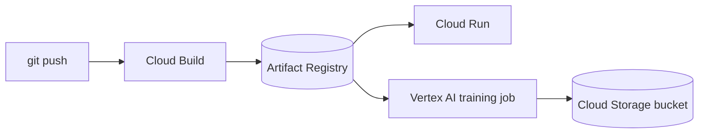

<!-- markdownlint-disable -->
<!-- Slidev syntax (per-slide frontmatter, per-slide headings) conflicts with the mkdocs markdownlint rules. -->

<!--
Pilot extraction of slides/day7_cloud.pdf (18 pages -> 18 slides).
Pipeline: extract_gamma_pdf.py --render (research/gamma-pdf-extraction branch),
then a vision pass over the page renders: glyph repair, colour emphasis,
figure descriptions. No Gamma click builds and no "Error uploading image"
placeholders were found in this deck, so no v-click merges were needed.
Images follow the routes from the image-recreation research: cheap ones are
redrawn inline; the rest are <Placeholder> boxes that describe the source image.
-->

# Cloud

## 02476 Machine Learning Operations

Nicki Skafte Detlefsen, Associate Professor, DTU Compute

January 2026

---

# Conceptually: What is the cloud

It is to data scientists what advance calculus was to mathematicians in the early 17th century: The power of infinity

<Placeholder kind="decorative" :page="2">
AI-generated-looking illustration: a white/grey cumulus cloud exploding outwards with orange fire, sparks and
lightning, and blue neon circuit lines, gears and floating UI panels, on a dark background. Pure mood image with no
information content. Regenerate, swap, or drop (author's call).
</Placeholder>

---

# Technical debt in ML

A fraction of real world ML systems is composed of ML code, the rest is infrastructure.

<!-- Redrawn from Sculley et al. (2015), Fig. 1: boxes of varying grey shades, with a tiny black "ML Code" box in the middle. -->
<div class="grid grid-cols-6 grid-rows-4 gap-2 text-xs text-center bg-white text-black p-3 rounded h-56">
  <div class="row-span-3 border-2 border-black flex items-center justify-center">Configuration</div>
  <div class="row-span-2 border-2 border-black bg-gray-100 flex items-center justify-center">Data Collection</div>
  <div class="row-span-2 border-2 border-black bg-gray-400 flex items-center justify-center">Data Verification</div>
  <div class="row-span-2 border-2 border-black bg-gray-200 flex items-center justify-center">Machine Resource Management</div>
  <div class="row-span-4 border-2 border-black flex items-center justify-center">Serving Infrastructure</div>
  <div class="row-span-2 border-2 border-black bg-gray-200 flex items-center justify-center">Monitoring</div>
  <div class="row-span-2 col-start-2 border-2 border-black bg-gray-200 flex items-center justify-center">Feature Extraction</div>
  <div class="col-start-3 row-start-3 flex items-center justify-center"><span class="bg-black text-white px-1 text-[0.5rem]">ML Code</span></div>
  <div class="col-start-4 row-start-3 border-2 border-black bg-gray-100 flex items-center justify-center">Analysis Tools</div>
  <div class="col-start-3 col-span-2 row-start-4 border-2 border-black bg-gray-300 flex items-center justify-center">Process Management Tools</div>
</div>

<div class="cite mt-1">After Sculley et al., "Hidden Technical Debt in Machine Learning Systems", NeurIPS 2015, Fig. 1.</div>

The cloud provides services to help lower the technical debt

---

# Why use cloud?

<div class="grid grid-cols-2 gap-4 mt-6">
<div class="border-2 border-accent rounded p-4">

### Reliability

Hardware failures, network outages, and system crashes require 24/7 monitoring and rapid response capabilities

</div>
<div class="border-2 border-accent rounded p-4">

### Scalability

Predicting capacity needs and provisioning hardware months in advance creates inflexibility and wasted resources

</div>
<div class="border-2 border-accent rounded p-4">

### Complexity

Modern infrastructure stacks involve networking, storage, compute, security, and orchestration—each requiring deep expertise

</div>
<div class="border-2 border-accent rounded p-4">

### Expertise

Hiring and retaining infrastructure specialists is expensive and challenging, especially for smaller organizations

</div>
</div>

---

# Why cloud exists?

<div class="grid grid-cols-[2fr_3fr] gap-8">
<div>

<!-- Re-plotted: compute demand over time as sharp blue spikes, all under a flat "Max compute" ceiling. -->
<svg viewBox="0 0 440 210" class="bg-white rounded w-full">
  <line x1="20" y1="30" x2="370" y2="30" stroke="#9ab" stroke-width="1" />
  <text x="372" y="28" fill="#333" style="font-size: 11px">Max</text>
  <text x="372" y="40" fill="#333" style="font-size: 11px">compute</text>
  <text x="300" y="14" fill="#333" style="font-size: 11px">Spikes in demand</text>
  <polygon fill="#4285f4" points="20,185 35,60 55,155 72,90 80,120 95,55 115,165 135,85 145,130 165,35 180,150 200,80 215,140 235,40 250,135 268,50 280,105 292,55 302,100 312,45 322,110 335,30 350,185" />
  <line x1="20" y1="20" x2="20" y2="185" stroke="#333" />
  <line x1="20" y1="185" x2="360" y2="185" stroke="#333" />
  <text x="330" y="202" fill="#333" style="font-size: 11px">Time</text>
</svg>

</div>
<div class="border-l-2 border-accent pl-6 text-sm">

1. All teams will henceforth expose their data and functionality through service interfaces
2. Teams must communicate with each other through these interfaces
3. There will be no other form of interprocess communication allowed: no direct linking, no direct reads of another team's data store, no shared-memory model, no back-doors whatsoever
4. It doesn't matter what technology they use—HTTP, Corba, Pubsub, custom protocols
5. <span class="text-accent">All service interfaces, without exception, must be designed from the ground up to be externalizable to developers in the outside world</span>
6. Anyone who doesn't do this will be fired

</div>
</div>

<div class="ml-[40%] text-sm">2002, Jeff Bezos</div>

It is this mindset of providing a lot of services that basically makes up cloud

---

# Pros and Cons of using cloud

<div class="grid grid-cols-2 gap-8">
<div>

### Benefits

- **Cost Savings:** Pay-as-you-go, no upfront hardware costs.
- **Global Accessibility:** Deploy worldwide, bringing services closer to users.
- **Scalability:** Instantly scale resources up or down with demand.
- **Unlimited Storage:** Store vast amounts of data without physical limits.
- **Automated Services:** Managed services handle backups, updates, and maintenance.

</div>
<div>

### Challenges

- **Data Control:** Third-party infrastructure raises privacy and compliance concerns.
- **Internet Dependency:** Requires stable internet; outages can be critical.
- **Vendor Lock-in:** Difficult to migrate due to proprietary services.
- **Security Concerns:** Shared infrastructure increases attack surface.
- **Cost Management:** Without governance, costs can spiral out of control.

</div>
</div>

---

# What is the cloud?

<Placeholder kind="meme" :page="7">
Two-panel meme with a stand-up comedian on stage. Left panel: "Me: telling grandma what is this GCP that I work on /
Grandma: oh, so you're renting computers?". Right panel: "You just insulted my entire industry", subtitle "But yes."
Memes are decided per deck: recreate, regenerate, or swap (author's call).
</Placeholder>

---

# In practice

1. Big data centers of interconnected computers.
2. A software stack on top

<Placeholder kind="photo" :page="8">
Photo of a data-center aisle: tall server racks on both sides lit in pink, cyan and blue, dense cabling, with a
presenter in a purple jumper standing in the aisle (looks like a keynote stage backdrop). Needs a licensed stand-in
or a fresh photo.
</Placeholder>

---

# Cloud vendors

<div class="grid grid-cols-2 gap-8">
<div>

AWS are still the largest player in the cloud market.

However the others are growing faster.

<br>

We are going to take a look at GCP.

(because they gave me credits)

</div>
<div>

<Placeholder kind="chart" :page="9">
Line chart "Cloud Provider Market Share Trend (IaaS, PaaS, Hosted Private Cloud)", share of worldwide revenues,
Q4 2018 to Q2 2024. Read off the chart, roughly: Amazon flat at ~31–34%; Microsoft rising from ~15% to ~23%;
"Others" (dashed) falling from ~27% to ~22%; Google rising from ~7% to ~12%; Alibaba, Oracle, Salesforce and IBM
all at or below ~5% and flat or falling. Source: Synergy Research Group. Re-plot from the source data with a citation.
</Placeholder>

</div>
</div>

---

# What does the cloud consist of

Each cloud vendor have a number of services

Depending on your application, only a subset is of interest

<Placeholder kind="screenshot" :page="10">
Screenshot of Google Cloud's "Developer cheat sheet" map view: a colour-coded treemap of GCP products grouped into
Compute, Storage, Database, Data Analytics, AI/ML, Networking, DevOps CI/CD, Identity and Security, Management and
Application, each tile a product icon and name (Cloud Run, Cloud Functions, Artifact Registry, Vertex AI, BigQuery, …).
Retake a fresh screenshot.
</Placeholder>

[https://cloud.google.com/products](https://cloud.google.com/products)

---
layout: center
---

# Exercise: what do you need?

<div class="border-l-4 border-accent pl-6 mt-6">

Based on your current knowledge about machine learning and what you have already learned in this course, what kind of services would you need from a cloud provider to do Machine Learning at Scale?

</div>

---
layout: center
---

# Important services for ML

<!-- Source shows each service's official GCP hexagon icon (blue) above a short label. TODO: icons per the logo route. -->
<div class="grid grid-cols-7 gap-2 mt-6 border rounded p-4 text-center">
  <div><div class="text-4xl">⬢</div>Engine</div>
  <div><div class="text-4xl">⬢</div>Bucket</div>
  <div><div class="text-4xl">⬢</div>Build</div>
  <div><div class="text-4xl">⬢</div>Registry</div>
  <div><div class="text-4xl">⬢</div>Vertex</div>
  <div><div class="text-4xl">⬢</div>Functions</div>
  <div><div class="text-4xl">⬢</div>Run</div>
</div>

<!--
Icons in the source, left to right: Compute Engine (chip), Cloud Storage (bucket/rows), Cloud Build (cube),
Artifact Registry ({ hexagons }), Vertex AI (dotted V), Cloud Functions ({...}), Cloud Run (play arrows).
-->

---

# Stuff you want to do VS stuff you have to do

<!--
Redrawn from a Google Cloud diagram: a three-tier pyramid. Top "Applications" holds Workloads (misspelt in the source
image; fixed here); middle "Technology stack"; base "Landing Zone". A divider on the right separates the top two
tiers (cheesecake photo, "Stuff you want to do") from the base (broccoli photo, "Stuff you have to do").
-->
<div class="flex flex-col gap-2 text-sm text-center mt-4">
  <div class="flex items-center gap-4">
    <div class="flex-1 text-xs opacity-60">Applications</div>
    <div class="bg-blue-400 text-white rounded px-3 py-1">Workloads</div>
    <div class="flex-1"></div>
  </div>
  <div class="flex items-center gap-2">
    <div class="w-28 text-xs opacity-60">Technology stack</div>
    <div class="flex-1 bg-blue-400 text-white rounded py-2">Compute</div>
    <div class="flex-1 bg-blue-400 text-white rounded py-2">Storage</div>
    <div class="flex-1 bg-blue-400 text-white rounded py-2">Data analytics</div>
    <div class="flex-1 bg-blue-400 text-white rounded py-2">Machine learning</div>
    <div class="flex-1 bg-blue-400 text-white rounded py-2">Containers</div>
    <div class="w-36">🍰 Stuff you want to do</div>
  </div>
  <hr class="opacity-40" />
  <div class="flex items-center gap-2">
    <div class="w-28 text-xs opacity-60">Landing Zone</div>
    <div class="flex-1 bg-blue-600 text-white rounded py-2">Cloud Identity</div>
    <div class="flex-1 bg-blue-600 text-white rounded py-2">Cloud IAM</div>
    <div class="flex-1 bg-blue-600 text-white rounded py-2">Networking</div>
    <div class="flex-1 bg-blue-600 text-white rounded py-2">Monitoring</div>
    <div class="flex-1 bg-blue-600 text-white rounded py-2">Billing</div>
    <div class="w-36">🥦 Stuff you have to do</div>
  </div>
</div>

---

# Cloud IAM policy

<!--
Redrawn from a Google Cloud diagram. Source: four colour-coded rows (blue Identity, green IAM role, yellow Resources,
red Conditions). Identity row: user account and service account icons with dotted arrows into a Group; all point to
an IAM role icon, which points to three resource icons (storage, compute, network). Conditions row: a policy-document icon.
-->
| | | |
|---|---|---|
| <span class="text-blue-400">**Identity**</span> | User account ⋯> Group <⋯ Service account | <span class="text-blue-400">**Who?**</span><br>john@ or gcp-app-dev@ <span class="bg-green-600 text-white rounded px-2 text-xs">Best practice</span> |
| <span class="text-green-400">**IAM role**</span> | (role) | <span class="text-green-400">**Can do what?**</span><br>Edit |
| <span class="text-yellow-400">**Resources**</span> | storage · compute · network | <span class="text-yellow-400">**On which resource?**</span><br>Compute Instance<br>in Project / Folder / Org. |
| <span class="text-red-400">**Conditions**</span> | (policy) | <span class="text-red-400">**Under which conditions?**</span><br>Monday-Friday only |

---

# How do I interact with the cloud?

<div class="grid grid-cols-3 gap-6 mt-4 text-center">
<div>

<Placeholder kind="screenshot" :page="15">Google Cloud Console welcome page in a browser window.</Placeholder>

## <span class="text-blue-400">Google Cloud Console</span>

</div>
<div>

<Placeholder kind="screenshot" :page="15">Terminal running <code>gcloud version</code>, listing Google Cloud SDK, bq, core, gcloud-crc32c and gsutil versions.</Placeholder>

## <span class="text-blue-400">gcloud cli</span>

And the bq cli and gsutil cli

</div>
<div>

<Placeholder kind="screenshot" :page="15">Compute Engine REST API reference page (v1.acceleratorTypes, v1.addresses) in a browser window.</Placeholder>

## <span class="text-blue-400">APIs</span>

And Infrastructure as Code (IaC) such as Terraform

</div>
</div>

<!-- The gcloud panel could become a real code block (`gcloud version` output) instead of a screenshot. -->

---

# A word of warning

Working in the cloud is…hard.

⚠️ Everything taking longer because extra layer of communication

⚠️ Syntax can be hard to remember

⚠️ A lot of services to be confused about

⚠️ Permissions, permissions,

The only way to learn is to use it. If you can, start simple and then scale up

---

# Lets take a look

[https://console.cloud.google.com](https://console.cloud.google.com)

<Placeholder kind="screenshot" :page="17">
Google Cloud Platform console dashboard for "My First Project": left nav (Home, Billing, IAM &amp; Admin, APIs &amp;
Services, Compute Engine, Cloud Storage, VPC network, Cloud Run, SQL, Kubernetes Engine, BigQuery) and dashboard cards
(Project info, APIs request chart, GCP status, Resources, Monitoring, Error Reporting, Trace, News). Retake a fresh
screenshot, or replace with the live demo.
</Placeholder>

---

# Meme of the day

<Placeholder kind="meme" :page="18">
Caption: "Me signing up for my 4th GCP account to get the $300 of free credits". Below, a 2×2 grid of the same
celebrity in four different disguises (fish hat, turban, headscarf, blonde wig with glasses), watermark @AaronNBrock.
Memes are decided per deck: recreate, regenerate, or swap (author's call).
</Placeholder>

---
layout: section
---

# Theme test slides

Prototype only: layouts this deck does not use yet

---
layout: quote
author: Cloud deck, slide 2 (verbatim)
---

> It is to data scientists what advance calculus was to mathematicians in the early 17th century: The power of infinity

---

# Talking to GCP from the terminal

```bash {1|3-4|6-8}
gcloud auth login

gcloud config set project my-mlops-project
gcloud config set compute/zone europe-west1-b

gcloud compute instances create my-instance \
    --machine-type=n1-standard-1 \
    --image-family=pytorch-latest-cpu --image-project=deeplearning-platform-release
```

Inline code looks like `gcloud storage ls gs://my-bucket` inside a sentence.

---

# From commit to running container



<div class="cite mt-4">Diagram styled by the theme's Mermaid setup; no per-deck colours.</div>
